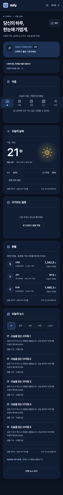

# Daily Briefing

### 오늘의 정보와 이동, 다음 약속을 한곳에.

**사용자가 필요한 정보를 직접 구성하는 개인화 Daily Dashboard.**

React·Spring Boot 애플리케이션부터 AWS 네트워크, 인증, CI/CD, 장애 대응과 비용 절감 운영까지 직접 설계한 개인 프로젝트입니다.

[서비스 접속](https://www.dailybriefing-son.site) · [클라우드 설계 상세](docs/ARCHITECTURE.md) · [로컬 실행](#로컬-실행) · [중단·재개 가이드](docs/INTERVIEW_OPERATIONS.md)

> 비용 관리를 위해 실제 서버를 중단한 기간에는 **샘플 체험**을 제공합니다. 화면의 LIVE / 샘플 표시로 구분하며, 샘플 체험에서는 가입·로그인·개인 서버 저장을 제공하지 않습니다. 공유 로그인 계정은 배포하지 않습니다.

## 프로젝트에서 집중한 것

| 관점 | 구현 |
| --- | --- |
| 제품 | 날씨·환율·뉴스·이동·일정을 사용자가 선택하고 순서를 저장하는 반응형 대시보드 |
| 클라우드 | CloudFront → ALB → Private ECS Fargate → Private RDS, NAT를 통한 외부 API 통신 |
| 자동화 | GitHub OIDC 기반 앱 배포, 이미지 digest 배포, API smoke 후 LIVE 전환 |
| 운영 | 요청 추적·오류 안내, 실행 설정 소유권 분리, 면접용 인프라 중단·스냅샷 복원 |
| 확장 | 독립 위젯과 Provider 경계, 선택적 AIOps 모듈, 향후 별도 AI 서비스 연동 |

## Cloud Architecture


[확대 가능한 SVG](docs/assets/architecture/cloud-architecture.svg) · [네트워크·보안·운영 결정 상세](docs/ARCHITECTURE.md)

첨부된 참고 구조처럼 **AWS Cloud → Region → VPC → Availability Zone → Public / Private Subnet** 경계를 구분했습니다. 그림은 현재 코드의 서비스 구성이며, 구현하지 않은 별도 DEV·DR 리전이나 HA 구성을 포함하지 않습니다.

### 요청은 어떻게 처리되는가

1. **가비아 DNS → CloudFront:** `www.dailybriefing-son.site`를 화면 주소로 사용합니다. DNS는 가비아에서 관리하며 Route 53은 사용하지 않습니다.
2. **정적 파일 → Private S3:** CloudFront OAC로 React 빌드와 공개 실행 설정을 제공합니다. S3를 인터넷에 직접 공개하지 않습니다.
3. **`/api/*` → ALB → ECS:** 브라우저는 동일 출처의 `/api/v1`을 호출합니다. CloudFront와 API 원본도 HTTPS로 연결하고 인증 API는 캐시하지 않습니다.
4. **ECS → RDS:** Spring Boot는 Public IP 없는 Private App Subnet에서 실행하며 PostgreSQL은 별도 Private DB Subnet에 배치합니다.
5. **ECS → NAT → 외부 API:** 날씨·환율·뉴스·장소·공휴일을 조회합니다. 지도 JavaScript SDK는 브라우저가 카카오 CDN에서 직접 읽습니다.

### 네트워크와 보안 선택

| 경계 | 정책과 설계 이유 |
| --- | --- |
| CloudFront → S3 | OAC·버킷 Public Access Block·TLS 정책으로 정적 원본 접근 제한 |
| CloudFront → ALB | ALB 443은 CloudFront origin-facing managed prefix list 허용. 특정 배포만 식별하는 전용 원본 인증까지 구현한 것은 아님 |
| ALB → ECS | ECS 8080은 ALB Security Group에서만 접근 |
| ECS → PostgreSQL | RDS 5432는 ECS Security Group에서만 접근, 공개 DB 접속 차단 |
| Private DB Subnet | 인터넷 기본 경로 없음. 운영 연결은 PostgreSQL TLS `verify-full` 사용 |
| Secret 주입 | API/JWT 키는 SSM 또는 Secrets Manager, DB 비밀번호는 RDS 관리 Secret. ECS Execution Role이 읽고 앱 Task Role에는 별도 AWS API 권한을 부여하지 않음 |
| 인증서 | 화면용 ACM은 `us-east-1`, API 원본용 ACM은 서울. Terraform 요청 → 가비아 DNS 검증 → 검증 완료 후 연결 |
| 브라우저 | CSP·HSTS·허용 Origin, Access Token 메모리 보관, Refresh Token HttpOnly / Secure / SameSite=Lax |

**현재 규모:** Fargate 1 Task, 운영 설정 0.25 vCPU / 1GiB, RDS `db.t4g.micro` / gp3 20GiB / Single-AZ, NAT Gateway 1개입니다. 두 AZ에 서브넷과 ALB를 구성했지만 두 번째 AZ에 실행 Task나 Standby DB는 없습니다. **전체 서비스의 고가용성을 보장하는 구조는 아닙니다.**

## CI/CD — 애플리케이션과 인프라의 책임 분리


[확대 가능한 SVG](docs/assets/architecture/delivery-architecture.svg)

| Workflow | 동작 |
| --- | --- |
| `verify` | Frontend 검사·테스트·빌드, Backend / PostgreSQL 통합 테스트, Docker·브라우저 검증, AIOps Mock 테스트 |
| `terraform-check` | AWS 자격증명 없이 fmt·초기화·validate·구조 검사 |
| `frontend-deploy` | main의 Frontend 변경 → 빌드 → 정적 파일 업로드 → index 무효화 → 샘플 체험 smoke |
| `backend-deploy` | main의 Backend 관련 변경 → 테스트 → amd64 이미지 → ECR. 별도 스위치 활성화 시 ECS 배포·API smoke·LIVE 전환 |
| `runtime-config` | 수동 실행으로 API 검증 후 LIVE 전환, 또는 STATIC_DEMO 전환. 이미지 빌드나 ECS 재배포 없음 |

- GitHub Environment별 IAM Role과 **OIDC 임시 자격증명**을 사용합니다. 장기 AWS Access Key를 GitHub에 저장하지 않습니다.
- `ci-실행ID-재시도번호` 태그와 **image digest**로 배포 이미지를 고정합니다. ECS가 아직 없어도 첫 이미지 업로드가 가능합니다.
- ECS 배포 완료 대기뿐 아니라 실제 신규 Task Definition 반영 여부를 확인합니다. 이전 버전으로 rollback되면 배포 성공으로 처리하지 않습니다.
- React 빌드는 재사용하고 `runtime-config.json`으로 샘플/LIVE와 공개 지도 키를 주입합니다. Frontend 배포는 이 파일을 덮어쓰지 않습니다.
- **Terraform plan / apply / destroy를 Actions에서 자동 실행하지 않습니다.** 인프라는 운영자가 계획과 비용을 검토한 뒤 직접 적용합니다.

[배포 순서·변수·롤백](docs/DEPLOYMENT.md) · [도메인과 인증서](docs/DOMAIN_SETUP.md)

## 비용을 고려한 면접용 운영

항상 켜두는 운영과 별개로, **화면·이미지·인증서는 유지하고 실행 인프라만 중단·복구**할 수 있도록 구성했습니다.

```text
running → prepare-suspend → suspended → running
          DB 삭제 정책 준비   최종 스냅샷    스냅샷 복원 + DNS + LIVE
```

| 보존 | 중단 시 제거·재개 시 생성 |
| --- | --- |
| CloudFront / S3 / ECR / ACM / VPC / 보안 그룹 / State | NAT·EIP / ALB / ECS / RDS 등 실행 자원 |

중단 전 샘플 체험으로 전환하고, DB 최종 스냅샷 정책을 먼저 적용합니다. 로컬 계획 검사로 준비 없는 DB 삭제·보존 자원 삭제·기존 DB 교체·스냅샷 없는 복원을 거절합니다. 재개 후 가비아 **api CNAME만 새 ALB 주소로 갱신**하며 www와 인증서 검증 레코드는 유지합니다.

**구현 및 로컬 테스트 완료, 실제 AWS 중단·복원 왕복 검증은 남아 있습니다.** 스냅샷·이미지·정적 파일·Secret 등 보관 비용은 남으며 무료 운영을 보장하지 않습니다. 면접 전날 복원과 실제 기능 확인을 진행하는 운영을 전제로 합니다.

[중단·복구 절차와 비용 주의](docs/INTERVIEW_OPERATIONS.md)

## Optional AIOps


[확대 가능한 SVG](docs/assets/architecture/aiops-architecture.svg)

**현재는 코드·Terraform·Mock 테스트가 준비된 상태이며 AWS 활성화와 실제 AI 분석·메일 수신 검증은 완료하지 않았습니다.** `enable_aiops=false`, `ai_enabled=false`가 기본입니다.

CloudWatch ERROR 로그와 ECS 실패 이벤트를 Lambda로 수집하여 **파싱 → 민감정보 마스킹 → 분류 → 중복/일일 한도 확인 → 선택적 AI 분석 → SNS 이메일**로 연결합니다. AI 실패나 한도 도달 시 기본 알림으로 대체하며, AIOps 처리 자체 실패는 별도 CloudWatch 알람으로 감지하도록 구성했습니다.

Lambda는 앱 VPC 밖에서 실행합니다. 인프라 자동 수정 권한은 부여하지 않으며, 모델 분석 결과가 곧 확정 원인이나 자동 복구 명령이 되지는 않습니다.

[설계·한계](docs/AIOPS_ARCHITECTURE.md) · [로컬 검증](docs/AIOPS_LOCAL_TEST.md) · [배포 체크리스트](docs/AIOPS_CHECKLIST.md)

## Product Experience


| Mobile Dashboard | Dashboard Edit |
| --- | --- |
|  |  |

| 기능 | 사용자 경험 |
| --- | --- |
| 개인 대시보드 | 위젯 선택·삭제·순서 저장. Desktop drag & drop, Mobile 위/아래 이동, 키보드 조작 |
| 날씨·환율 | 기본 지역과 현재 위치 날씨, 통화별 값·변동·업데이트 시각, 데이터 출처 표시 |
| 뉴스 | IT·경제·사회·국제·스포츠별 탐색과 더 보기, 분야별 실패 격리, 원문 연결 |
| 이동 | 장소 검색·현재 위치·지도 핀 선택, 좌표 대신 주소, 제공 경로 중 최단 소요시간 1개, 즐겨찾기 |
| 개인 일정 | 월간 달력·모바일 agenda, 다가오는 일정 3개, 계정별 CRUD |
| 계정·설정 | 가입·로그인·온보딩, 지역·관심 뉴스·테마, 비밀번호 변경·탈퇴 |
| 오류 안내 | 원인·해결 단계·오류 코드·요청 번호, 위젯별 Loading / Error / Empty / Retry |

화면 이미지는 저장소의 검증용 화면 예시이며, 표시 데이터가 현재 LIVE 값이라는 뜻은 아닙니다. 대기질·주식·둘러보기는 현재 서비스 범위에서 제외했습니다.

## Application Design

| 문제 | 선택한 구현 |
| --- | --- |
| 새로운 정보 서비스 추가 | Widget registry + 공통 상태 UI. 각 위젯은 독립 Query로 로딩·오류를 격리 |
| 외부 공급자 교체·장애 | Provider Client / 외부 DTO / Mapper / 내부 모델 분리, 연결·응답 timeout |
| 계정 간 데이터 혼합 | JWT principal로 소유자 결정, 사용자별 Query key, 계정 전환 시 개인 캐시 제거 |
| 로그아웃 후 인증 유지 | Refresh rotation·토큰 hash 저장·session family 검증, 성공 후 메모리 토큰과 Query 제거 |
| 동시 개인 설정 변경 | Dashboard version 충돌 처리, 즐겨찾기 재정렬 시 사용자 단위 잠금 |
| DB 정합성과 이력 | PostgreSQL + Flyway, FK cascade, 실제 PostgreSQL Testcontainers |
| 과도한 초기 분산 구조 | Spring Boot modular monolith. Kubernetes·Kafka·Redis를 필수 구성으로 추가하지 않음 |

TanStack Query는 서버 상태, Zustand는 메모리 인증·테마 등 Client 상태를 담당합니다. Access Token은 15분, Refresh Token은 14일이며 Refresh 원문은 DB에 저장하지 않습니다. 저장 요청은 무조건 자동 재시도하지 않습니다.

### 운영 중 발견한 문제와 개선

| 증상 | 원인과 개선 |
| --- | --- |
| 지도 SDK 승인 후에도 준비 중에서 멈춤 | 추가 지도 엔진 CDN이 CSP에서 누락됨. 허용 주소를 보완하고 기존 SDK 재사용 경로에도 초기화 제한 시간 적용 |
| Terraform 적용 후 LIVE가 샘플로 전환 | S3 객체 메타데이터 차이가 초기 내용을 재업로드. 실행 설정의 내용·메타데이터 소유권을 Actions로 통일 |
| 로그아웃 FORBIDDEN | 오래된 CSRF 토큰 재사용 조건을 테스트로 재현. 변경 요청 직전에 토큰을 확인하고 동시 조회만 공유 |

오류를 숨기거나 CSRF를 끄는 대신 원인을 구분하고 회귀 테스트를 추가했습니다. [문제 해결 기록](docs/TROUBLESHOOTING.md)

## Tech Stack

| 영역 | 기술 |
| --- | --- |
| Frontend | React 19 · TypeScript · Vite 7 · React Router · Tailwind CSS 4 · Radix UI · dnd-kit |
| State | TanStack Query · Zustand |
| Backend | Java 21 · Spring Boot 3.5 · Spring Security · JPA · Actuator · springdoc |
| Database | PostgreSQL 17 · Flyway V1–V8 |
| Cloud / Delivery | AWS S3 · CloudFront · ECS Fargate · ECR · ALB · RDS · NAT · ACM · SSM / Secrets Manager · CloudWatch · Terraform · GitHub Actions |
| Test | JUnit · Spring Boot Test · Testcontainers PostgreSQL · Vitest · Testing Library · Playwright |
| Optional AIOps | Python Lambda · EventBridge · DynamoDB · SNS · OpenAI API (미활성화) |

### 외부 데이터 공급자

| 정보 | 연동 | 설정 |
| --- | --- | --- |
| 날씨 | 기상청 단기예보 | KMA_API_KEY — 공공데이터포털 Decoding 키 |
| 환율 | 한국수출입은행 | KOREA_EXIM_API_KEY |
| 뉴스 | NAVER API HUB Search | NAVER_API_CLIENT_ID / NAVER_API_CLIENT_SECRET |
| 장소·경로 | 카카오맵 REST | KAKAO_REST_API_KEY |
| 지도 | Kakao Maps Web SDK | 공개 JavaScript 키, 실제 HTTPS 도메인 등록 |
| 공휴일 | KASI 특일정보 | KASI_API_KEY |

뉴스 초기 조회는 5개 분야별 5건이며 더 보기로 선택 분야를 추가 조회합니다. API 키·쿼터·이용 승인 조건은 공급자별로 다릅니다. 서버 Secret을 브라우저에 주입하지 않습니다. [발급·연결 가이드](docs/API_SETUP.md) · [외부 API 계약](docs/EXTERNAL_APIS.md)

## 로컬 실행

필수: Docker Engine + Compose. 개별 개발은 Node.js 22.13+ / Java 21을 사용합니다.

```bash
cp .env.example .env
# .env의 DB_PASSWORD / JWT_SECRET을 로컬 전용 값으로 변경
# 외부 API 키 없이 시작하려면 DATA_MODE=DEMO 유지
docker compose up --build -d --wait
```

접속: **http://localhost:5173**. Compose는 Frontend·Spring Boot·PostgreSQL을 실행하고 Flyway가 스키마를 구성합니다. backend와 DB는 기본 설정에서 host port를 공개하지 않습니다. DEMO 정보와 별개로 계정·일정·설정은 로컬 PostgreSQL에 저장됩니다.

```bash
docker compose logs --tail=100 backend
docker compose down
```

`down`은 named volume을 유지합니다. `down -v`는 계정과 개인 데이터를 지우므로 일상 종료에 사용하지 않습니다. 로컬 `.env`·실제 tfvars·State·계획 파일은 Git에서 제외합니다.

[개별 개발 모드와 환경변수](docs/ENV_LOCAL_GUIDE.md) · [Docker / AWS 환경 비교](docs/LOCAL_VS_AWS.md)

## Testing & Verification

```bash
# Frontend
npm --prefix frontend ci
npm --prefix frontend run lint
npm --prefix frontend run typecheck
npm --prefix frontend test
npm --prefix frontend run build

# Backend — Docker 실행 필요. PostgreSQL을 H2로 대체하지 않음
./backend/gradlew -p backend test integrationTest bootJar

# 로컬 운영 도구 — AWS/실제 AI 호출 없음
python3 scripts/test-interview.py
python3 scripts/test-deploy-backend.py
python3 scripts/test-check-deploy-env.py
python3 scripts/test-set-runtime.py
```

CI는 여기에 Compose 및 Desktop/Mobile Playwright, AIOps Mock 검증을 연결합니다. 실제 외부 API 호출·AWS 과금·메일 수신까지 자동으로 검증한 것으로 취급하지 않습니다. 최신 실행 결과는 [GitHub Actions](https://github.com/Son-github/dailybriefing/actions)에서 확인할 수 있습니다.

2026-10-26 로컬 기준 Frontend **42개**, 배포·운영 Python 테스트 **28개**를 확인했습니다. Backend·브라우저의 과거 검증과 실제 AWS 운영 검증은 구분해 기록합니다. [테스트 전략](docs/TESTING.md) · [검증 기록](docs/VERIFICATION.md)

## Repository Map

```text
frontend/src/       # auth · dashboard · transit · calendar · news · profile
backend/src/        # feature 중심 API / service / persistence / provider
infra/              # 단일 Main State, 9개 서비스 모듈, ACM·면접 운영 모드
infra/bootstrap/    # State용 S3의 별도 Root
lambda/aiops/       # 선택적 장애 분류·마스킹·분석·알림
scripts/            # 배포 검사·런타임 설정·중단/재개·검증 도구
docs/               # 제품 설계·설정·운영·검증·아키텍처 원본
```

코드를 읽을 때는 [기능별 코드 가이드](docs/CODE_GUIDE.md)에서 진입점을 확인할 수 있습니다. API 계약은 개발용 Swagger(`http://localhost:8080/swagger-ui/index.html`, 개발 모드에서 backend 포트 노출 시)로 확인하며 운영 환경에서는 비활성화합니다.

## 남은 검증과 다음 확장

- AIOps: 로컬 재검증 → AI OFF로 실제 알림 연결 → 사용량 제한 확인 후 AI 활성화
- 면접용 운영: 실제 최종 스냅샷 생성·복원·DNS 갱신 왕복 검증
- 성능/가용성: 부하·메모리 측정 후 Task 다중 AZ, RDS Multi-AZ, NAT 가용성 검토
- AI/MLOps: 라이선스를 확인한 별도 데이터와 외부 Python 추론 서비스 경계. 뉴스 감성 분석·학습/평가/모델 배포 파이프라인은 미구현

운영 성능·가용성·비용 절감 수치는 실측 전까지 성과로 주장하지 않습니다. 아키텍처 그림은 [AWS 공식 아이콘](https://aws.amazon.com/architecture/icons/)을 사용했으며 [SVG 원본과 재생성 방법](docs/assets/architecture/README.md)을 함께 제공합니다.
