# Daily Briefing

GitHub 업로드와 Actions 배포 순서는 [GitHub 업로드 가이드](docs/GITHUB_UPLOAD.md)를 참고하세요.

**내 이동, 다음 약속, 오늘의 정보를 한눈에 확인하는 개인화 Daily Information Platform.**

Daily Briefing은 여러 API의 결과를 나열하는 화면에서 출발하지 않습니다. 사용자가 매일 확인할 정보를 직접 고르고, 자신에게 필요한 순서로 구성하며, 모바일과 데스크톱에서 같은 개인 공간을 이용하도록 설계했습니다.

React와 Spring Boot의 독립 위젯 구조, PostgreSQL의 개인 데이터 정합성, 인증·삭제 정책, Docker 통합 실행과 자동화 테스트를 함께 구현한 프로젝트입니다. AWS 인프라와 선택적 AIOps를 별도 모듈로 관리하며, 뉴스 AI/MLOps는 이후 확장을 위한 경계만 유지합니다. 실제 AWS 리소스 생성과 유료 AI 호출은 수행하지 않았습니다.

> 기본 실행은 **DEMO 데이터 모드**입니다. 개인 일정·즐겨찾기·인증·대시보드 설정은 실제 PostgreSQL에 저장됩니다. 외부 정보의 샘플/실제 출처는 화면에 표시합니다. 실제 교통의 지원 범위와 API 키 설정은 아래를 확인하세요.

## 화면

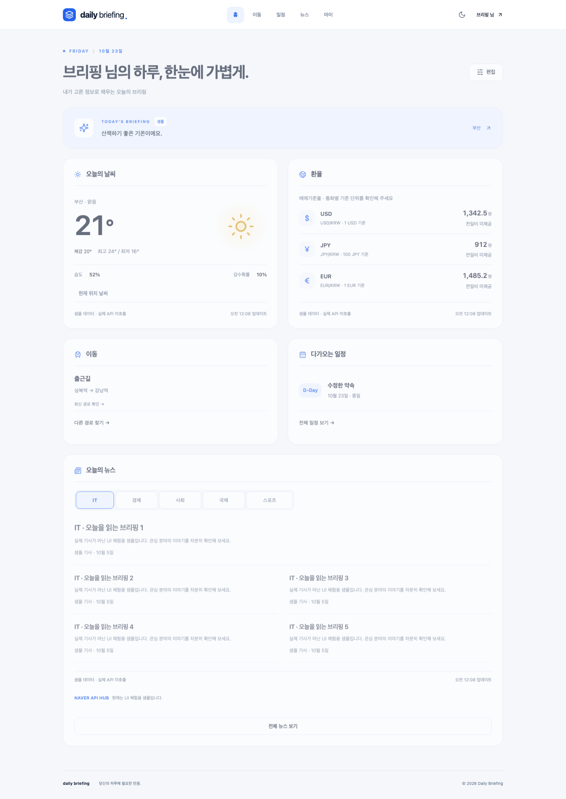

| Mobile Dashboard                            | Mobile Editor                            |
| ------------------------------------------- | ---------------------------------------- |
| 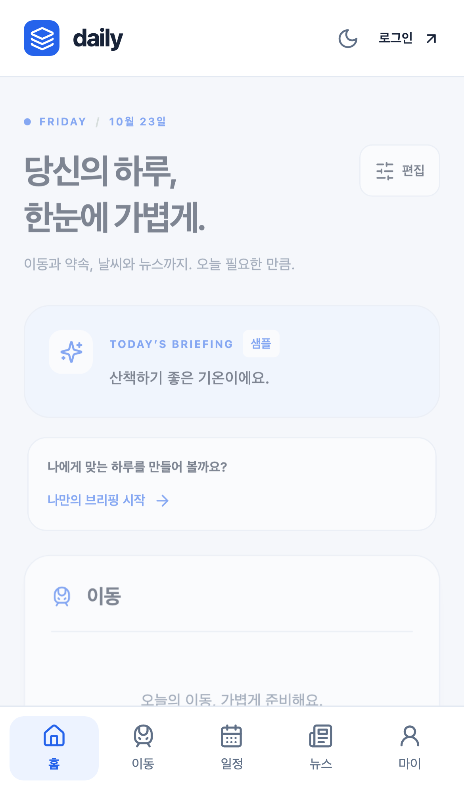 | 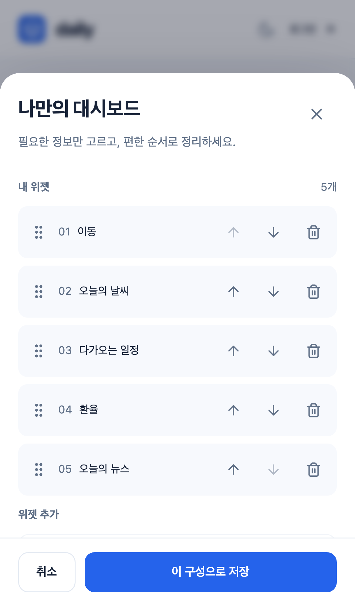 |

| 이동 경로                                   | 개인 Calendar                                 |
| ------------------------------------------- | --------------------------------------------- |
| 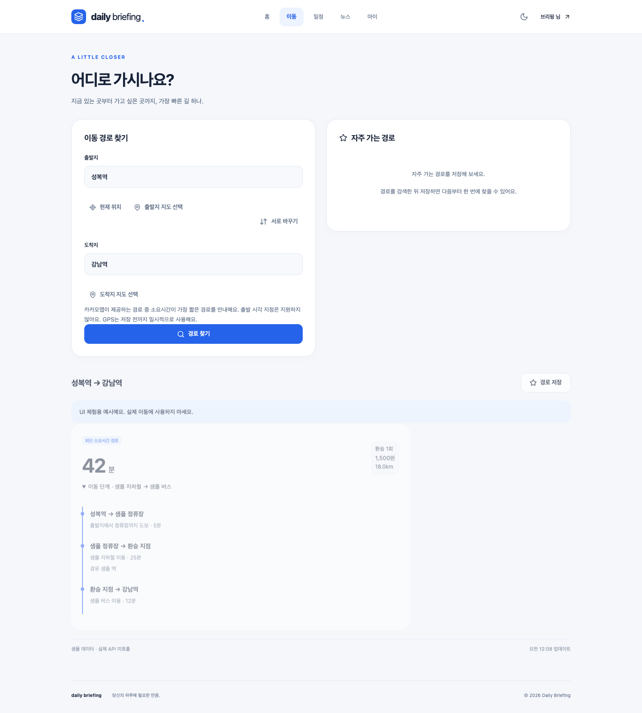 | 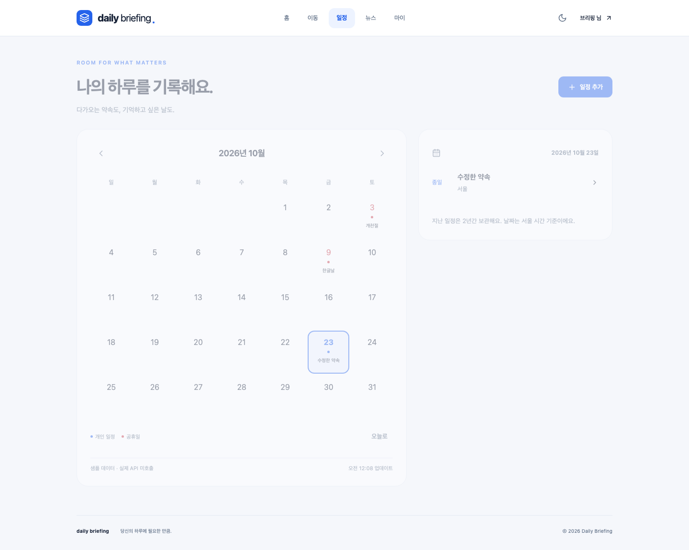 |

오류가 발생하면 원인과 해결 방법을 안내합니다.

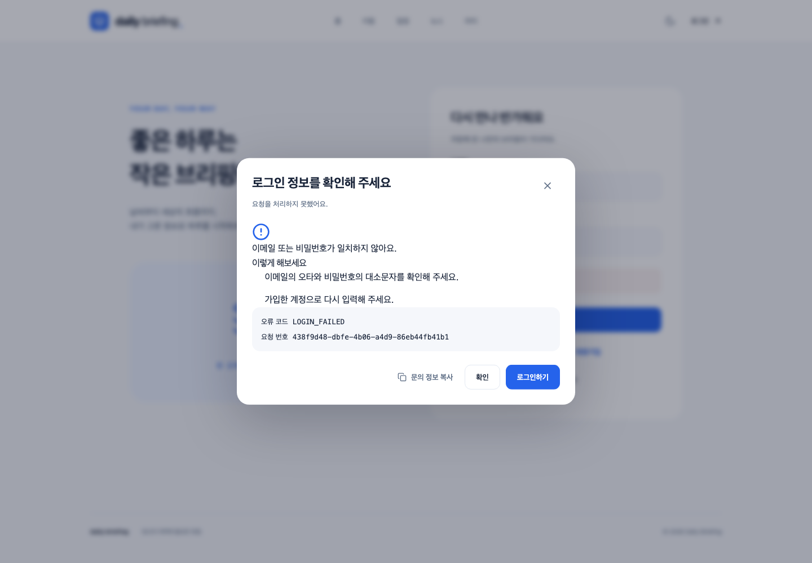

## 핵심 사용자 경험

- **나만의 대시보드**: 이동·날씨·다가오는 일정·환율·뉴스를 선택하고 순서를 저장합니다. 데스크톱 drag & drop, 키보드 이동, 모바일 위/아래 버튼을 제공합니다.
- **빠른 이동 확인**: 현재 위치/GPS, 장소 자동완성, 지도 선택, 장소 교환, 최단 소요시간 경로 1개와 이동 단계를 표시합니다. 자주 가는 경로는 필수 이름(30자)과 순서를 관리합니다.
- **다음 일정 3개**: Dashboard에서 D-Day를 바로 확인하고 전체 Calendar로 이동합니다. 데스크톱은 월간 달력과 일정 panel, 모바일은 날짜 선택과 agenda 목록입니다.
- **안심할 수 있는 개인화**: API의 사용자 식별은 JWT principal에서 결정합니다. 다른 계정의 일정/즐겨찾기 수정·삭제는 404로 처리합니다.
- **삭제 정책**: 직접 삭제와 회원탈퇴는 hard delete. 2년 경계보다 오래된 일정은 서울시각 매일 03:00에 일괄 정리합니다. 탈퇴 시 개인 데이터와 인증 session은 FK cascade로 함께 삭제됩니다.
- **독립적인 데이터 상태**: 각 위젯의 Skeleton/Error/Retry/Empty가 독립적으로 동작합니다. 공휴일 API가 실패해도 개인 일정은 계속 사용할 수 있습니다.
- **서비스를 먼저 경험**: Guest는 정보·경로·공휴일 조회와 브라우저 내 대시보드 편집을 사용할 수 있습니다. 로그인 후 일정과 경로를 기기 간 저장합니다.
- **Appearance**: Light / Dark / System, reduced motion, 44px 모바일 controls, 포커스 관리, 화면 낭독기용 labels를 제공합니다.

## 기술 스택

| 영역        | 사용 기술                                                                               |
| ----------- | --------------------------------------------------------------------------------------- |
| Web         | React 19, TypeScript, Vite 7, React Router                                              |
| State       | TanStack Query: 서버 상태 / Zustand: memory 인증·theme                                  |
| UI          | Tailwind CSS 4, 재사용 가능한 UI components, Radix Dialog, lucide, dnd-kit              |
| API         | Java 21, Spring Boot 3.5, Security, JPA, Validation, springdoc                          |
| DB          | PostgreSQL 17, Flyway V1–V8                                                             |
| Reliability | timeout, request ID, Actuator, Micrometer, 원인별 오류 안내창                           |
| Tests       | JUnit, Spring Boot Test, Testcontainers PostgreSQL, Vitest, Testing Library, Playwright |
| Runtime     | Docker multi-stage images, Compose, non-root nginx/JVM containers                       |

Redis, Kubernetes, Kafka, microservices는 사용하지 않습니다. Backend는 feature 중심 modular monolith입니다.

## Architecture

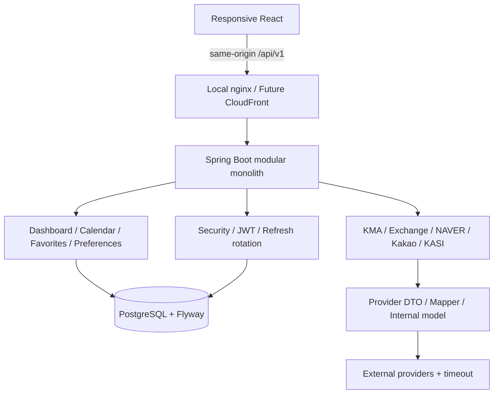

사용자 일정과 즐겨찾기의 source of truth는 PostgreSQL입니다. 서버 외부 응답 cache/Caffeine/Redis는 사용하지 않습니다. TanStack Query는 독립된 widget의 서버 상태를 관리합니다.

### 주요 설계 결정

| 문제                            | 구현                                                 | 이유                                           |
| ------------------------------- | ---------------------------------------------------- | ---------------------------------------------- |
| 위젯마다 UI가 달라짐            | 공통 Card/QueryContent + widget registry             | 새 위젯을 추가할 때 기존 위젯 수정 최소화      |
| 모바일 drag 조작 어려움         | 위/아래 이동 버튼과 삭제                             | 터치·키보드 기능 parity                        |
| 개인 정보가 이전 계정에 남음    | user ID query key + 로그인/로그아웃/탈퇴 cache clear | 같은 브라우저의 계정 전환 격리                 |
| 탈퇴 후 자식 데이터가 남음      | PostgreSQL FK ON DELETE CASCADE                      | 한 transaction으로 orphan 없이 삭제            |
| 모든 일정을 읽고 3개를 선택     | SQL ORDER BY + LIMIT 3                               | 사용자 수와 일정 수 증가에 대응                |
| API 호출마다 오래된 일정 삭제   | 하루 1회 bulk cleanup                                | 요청 경로에서 불필요한 쓰기 제거               |
| 서울 날짜가 UTC 변환으로 달라짐 | DB DATE/TIME, Clock Asia/Seoul, 날짜 문자열          | D-Day 및 정리 경계 일관성                      |
| 동시에 즐겨찾기를 재정렬        | 사용자 row lock, 최대20개                            | 같은 계정의 순서 변경만 직렬화                 |
| Provider 불완전한 데이터        | 명시적 지원 범위/empty/error                         | 근거 없는 이동시간을 실제 값처럼 표시하지 않음 |

## 시작하기

필요: Docker Desktop(또는 Docker Engine + Compose). 개별 개발에는 Node **22.13+**, Java **21**이 필요합니다.

```bash
cp .env.example .env
docker compose up --build -d --wait
```

- Web: http://localhost:5173
- Backend / PostgreSQL은 기본 Compose에서 host port를 공개하지 않습니다.
- PostgreSQL service DNS는 `postgres`, 데이터는 named volume에 저장합니다.
- 새 DB에도 Flyway가 자동 적용됩니다. 기존 DB는 새 migration을 순서대로 적용합니다. 역 기반 즐겨찾기는 이름을 보존하고 좌표 재선택을 안내합니다.
- 데모 로그인 계정은 만들지 않습니다. 화면에서 회원가입하세요.

```bash
docker compose ps
docker compose logs --tail=100 backend
docker compose down
```

`down`은 데이터를 유지합니다. **`down -v`는 개인 일정/계정까지 지우므로 초기화가 필요한 경우에만 사용하세요.**

### Development Mode

```bash
docker compose -f compose.yaml -f compose.dev.yaml up -d postgres
```

`.env`를 로컬 backend 실행 환경에 전달합니다. JVM 프로세스는 `.env`를 자동으로 읽지 않습니다.

```bash
set -a
source .env
set +a
cd backend
./gradlew bootRun
```

별도 터미널:

```bash
cd frontend
npm ci
npm run dev
```

Vite는 `/api`를 로컬 backend로 proxy합니다. `compose.dev.yaml`은 DB5432/backend8080을 loopback으로 노출합니다. Integration 서비스와 개별 개발 서버를 동시에 같은 포트에서 실행하지 마세요.

## API 공급자와 설정

| 기능          | Provider            | 준비 사항                                                            |
| ------------- | ------------------- | -------------------------------------------------------------------- |
| 장소/GPS 주소 | Kakao Local         | KAKAO_REST_API_KEY                                                   |
| 지도          | Kakao Maps Web      | VITE_KAKAO_MAP_KEY(JavaScript 공개키) + SDK domain 등록              |
| 대중교통 | 카카오맵 REST API | REST API 키 + 카카오맵 사용 설정 ON, 무료 쿼터/유료 조건 확인 |
| 날씨          | 기상청 KMA 단기예보 | KMA_API_KEY, 국내 격자/발표시간 자동 변환                            |
| 공휴일        | KASI 특일정보       | KASI_API_KEY                                                         |
| 환율          | 한국수출입은행      | KOREA_EXIM_API_KEY, BigDecimal/100엔 단위 표시                       |
| 뉴스          | NAVER API HUB Search        | NAVER_API_CLIENT_ID/SECRET, 5분야×5개, 탭·더 보기, 안전한 plain text |

발급 단계/Local 확인/적용 명령은 [API_SETUP](docs/API_SETUP.md), Raw→내부 계약/단위/한도는 [EXTERNAL_APIS](docs/EXTERNAL_APIS.md)를 확인하세요.

**모든 API가 무조건 무료인 것은 아닙니다.** 카카오맵 대중교통은 [앱 사용 설정 및 무료 쿼터/유료 이용 조건](https://developers.kakao.com/docs/ko/kakaomap/common)을 확인해야 합니다. 다른 API도 앱의 현재 쿼터·승인·운영 이용 조건을 확인해야 합니다. 지도 JavaScript 키 외 secret은 frontend에 전달하지 않습니다. NAVER 뉴스는 AI 모델 입력/학습에 사용하지 않습니다.

### 오류를 이해하고 해결하기

오류창에 원인, 해결 단계, 오류 코드, 요청 번호가 표시됩니다. 네트워크/시간초과/로그인 만료/API 키·승인/호출 한도/데이터 형식/입력 문제를 구분합니다. 조회는 다시 시도할 수 있고, 저장 요청은 중복 저장을 피하기 위해 자동 재실행하지 않습니다. 초기 guest refresh의 정상401은 안내하지 않습니다. 동시에 여러 위젯이 실패해도 창은 하나만 표시하고 개별 widget의 `문제 해결 방법`으로 다시 열 수 있습니다.

### 직접 수정할 설정

- DB_HOST/PORT/NAME/USERNAME/PASSWORD: Local PostgreSQL → Compose postgres → RDS endpoint.
- JWT_SECRET: 최소32 UTF-8 bytes, 공유/운영 환경에서는 반드시 교체.
- FRONTEND_URL: 정확한 HTTPS CORS origin. COOKIE_SECURE는 운영 true.
- DATA_MODE: DEMO(샘플)/LIVE(공급자 호출, 실패 시 샘플 fallback 없음).
- 외부 키와 URL: `.env.example`의 provider별 주석/위 표 참고.
- API_CONNECT_TIMEOUT_MS/READ_TIMEOUT_MS: 기본2000/4000ms.
- CALENDAR_CLEANUP_ENABLED/CRON: 한 인스턴스에서 서울03:00 실행.
- VITE_API_BASE: `/api/v1`, VITE_KAKAO_MAP_KEY는 등록 domain으로 제한한 공개 JavaScript 키.

환경변수를 변경하면 backend recreate, VITE 변수를 변경하면 frontend rebuild가 필요합니다. 기존 `.env`에 신규 키를 추가하고 실제 값을 Git에 넣지 마세요.

## 데이터 모델과 삭제

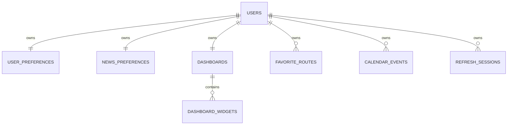

- `calendar_events(user_id,event_date,event_time)`: 범위 조회와 Upcoming 3.
- `calendar_events(event_date)`: 전역 날짜 정리.
- `favorite_routes(user_id,display_order)`: 계정별 정렬. 동일 출발/도착은 UNIQUE.
- `dashboard_widgets`의 `(dashboard_id,position)` UNIQUE index는 순서 조회에도 사용.
- 모든 user FK와 dashboard child FK는 DB cascade. JPA 자식 삭제 정책을 중복하지 않음.

```sql
-- 오늘부터의 일정(종일은 해당 날짜의 시간 지정 일정 다음에 표시)
SELECT * FROM calendar_events
WHERE user_id = :authenticatedUser AND event_date >= :seoulToday
ORDER BY event_date, event_time NULLS LAST, id LIMIT 3;

-- cutoff = LocalDate.now(Asia/Seoul).minusYears(2)
DELETE FROM calendar_events WHERE event_date < :cutoff;
```

2028-10-05 정리 시 **2026-10-05는 유지**, 그 이전만 삭제합니다. 직접 삭제는 즉시 반영됩니다. 회원탈퇴는 비밀번호 확인→user 삭제→DB cascade→refresh cookie 삭제→Frontend 인증/query 제거입니다. 같은 이메일로 다시 가입하면 새로운 UUID와 기본 설정을 가지며 이전 데이터는 연결되지 않습니다.

기존 Flyway V1–V4 이력은 checksum을 위해 유지합니다. 종료된 테이블은 신규 V5에서 삭제하고 V6에서 개인 일정·즐겨찾기를 생성합니다. V7은 종료된 widget을 정리하고 V8은 좌표 기반 즐겨찾기로 전환합니다. 실행 후 종료된 테이블이 없는지 통합 테스트로 확인합니다.

## 인증·운영

- BCrypt12, JWT access15분(메모리), random refresh14일(HttpOnly SameSite Lax cookie).
- refresh hash만 DB 저장, rotation, 재사용 시 family 폐기.
- access의 session family도 DB 검증하므로 로그아웃/비밀번호 변경/탈퇴 후 즉시 무효.
- cookie 기반 auth 요청에는 CSRF cookie/header 적용, CORS origin 제한.
- requestId / method / endpoint / status / latency 및 provider 결과·latency 로그.
- Password/JWT/refresh/API key/개인 일정 메모는 로그에 기록하지 않음.
- `/actuator/health`, `/actuator/health/readiness`는 DB 상태를 포함.
- `/actuator/metrics`는 기본 외부 공개하지 않음. 운영 Swagger 비활성화.

## API Documentation

개발용 backend port를 열었을 때 http://localhost:8080/swagger-ui/index.html 에서 요청 계약을 확인합니다. `/api/v1` 기준:

| API                                                                     | 인증                    |
| ----------------------------------------------------------------------- | ----------------------- |
| POST auth/signup, login, refresh, logout                                | cookie/CSRF 전략        |
| GET/PUT/DELETE users/me, PUT users/me/password                          | bearer                  |
| GET dashboard                                                           | Guest/사용자            |
| PUT dashboard                                                           | bearer, version 충돌409 |
| GET mobility/places, mobility/location, POST mobility/routes            | 공개 / POST는 CSRF      |
| GET/POST me/mobility/favorites, PATCH/DELETE me/mobility/favorites/{id} | bearer + 소유자 조건    |
| GET/POST me/calendar/events, PATCH/DELETE me/calendar/events/{id}       | bearer + 소유자 조건    |
| GET me/calendar/events/upcoming                                         | bearer, 항상 최대3개    |
| GET calendar/holidays                                                   | 공개                    |
| GET weather, exchange-rates, news, briefing                             | 공개                    |

세부 파라미터와 flow는 [변경 설계](docs/V2_MOBILITY_UPGRADE.md), 에러 형식은 `Errors`를 참고합니다.

## 뉴스 탐색

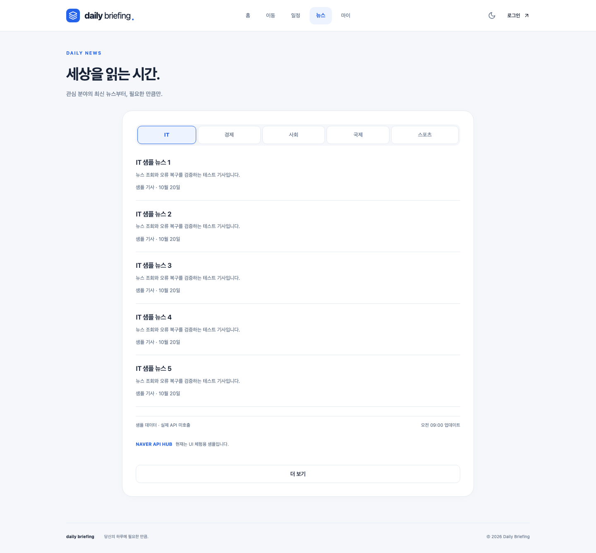

초기에는 IT·경제·사회·국제·스포츠를 병렬로5개씩 조회하고 선택한 분야5개만 표시합니다. 탭 전환은 추가 호출 없이 즉시 반영하며, 뉴스 페이지의 **더 보기**는 선택 분야만10개씩 추가합니다. 일부 분야의 실패는 다른 분야에 영향을 주지 않고 재시도는 실패 분야만 요청합니다. 제공된 순서·제목·설명을 유지하며 뉴스 DB/cache/AI 처리와 가상의 이미지·언론사 정보는 사용하지 않습니다.

API: `GET /api/v1/news/sections`, `GET /api/v1/news?category=IT&start=6&display=10`. 설계: [NEWS_UPGRADE](docs/NEWS_UPGRADE.md). NAVER API HUB 키 설정·출처 표시는 [API_SETUP](docs/API_SETUP.md)을 참고하세요.

## 검증 방법

```bash
cd frontend
npm run lint
npm run typecheck
npm test
npm run build
```

```bash
cd backend
./gradlew test integrationTest bootJar
```

Testcontainers는 실제 PostgreSQL을 사용합니다. Docker가 실행 중이어야 하며 H2 대체 테스트는 없습니다.

```bash
# 프로젝트 root
docker compose build
docker compose up -d --wait
# frontend
npm run test:e2e
```

실제 desktop/mobile browser로 회원가입→온보딩→이동검색→즐겨찾기→일정 생성/수정/삭제→재로그인 유지→회원탈퇴를 검증합니다. PostgreSQL 테스트는 계정 A/B 격리와 탈퇴 후 모든 개인 table의 row count, 기존 token 실패, 재가입의 신규 데이터도 검증합니다.

실행 결과: [VERIFICATION](docs/VERIFICATION.md). 다음 변경을 검증하는 방법과 수동 점검표: [TESTING](docs/TESTING.md).

## 코드를 읽는 순서

[CODE_GUIDE](docs/CODE_GUIDE.md)에 기능별 진입점과 Controller→Service→Repository, Provider→Mapper→DTO 흐름을 설명했습니다. 주석은 코드를 반복 설명하기보다 **왜 이렇게 작성했는지**, **무엇을 설정해야 하는지**, **어디를 확장해야 하는지**에 집중합니다.

```text
frontend/src/
  features/
    auth/ onboarding/ profile/ dashboard/
    transit/ calendar/ news/ weather/ exchange/
  components/ui/ layout/
  lib/ types/ test/
backend/src/main/
  java/com/dailybriefing/
    auth/ user/ security/ dashboard/
    transit/ calendar/ weather/ exchange/ news/ briefing/
    provider/ common/ config/
  resources/
    application-{local,test,prod}.yml
    db/migration/
docs/                       # 설계, 코드·설정 가이드, 검증, AWS readiness
```

## 향후 AWS / AI / MLOps

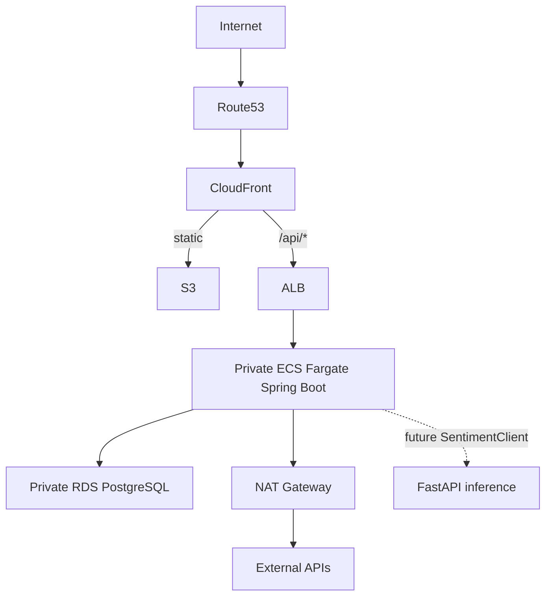

React `dist`는 S3 정적 artifact, backend는 동일 Docker image, DB는 endpoint 환경값만 교체합니다. CloudFront API behavior는 cache 비활성화·Authorization/Cookie/CSRF header forwarding이 필요합니다. ALB health/readiness, private ECS 외부 통신, trusted forwarded headers, secret 주입을 점검합니다. 실제 AWS 검증은 수행하지 않았습니다. [현재 목표 구조](docs/ARCHITECTURE.md), [첫 설정](docs/AWS_SETUP.md), [AWS readiness](docs/AWS_READINESS.md).

향후 AI는 라이선스가 허용된 별도 데이터와 `SentimentClient` 경계로 연결합니다. NAVER 검색 결과는 입력/학습에 사용하지 않습니다. 모델/학습 코드를 Java에 넣지 않습니다. Dataset→Training→Evaluation→Registry→Inference→Monitoring은 별도 phase입니다.

## 현재 제한과 다음 단계

1. **LIVE 승인/검증**: 카카오맵 사용 설정과 각 공급자 실제 키가 필요합니다. 키 없는 fixture/DEMO 검증을 LIVE 성공으로 간주하지 않습니다.
2. **정보 정확성**: KMA는 단기예보이며 관측/체감온도가 아닙니다. 최고최저/실제교통요금/전일환율이 공급자에 없으면 미제공으로 표시합니다. 수출입은행 휴일 미공표는 오류 안내합니다.
3. **실기기 QA**: 자동화 mobile viewport 외 iOS Safari/Android, screen reader, HTTPS GPS 권한을 점검해야 합니다.
4. **운영 강화**: 이메일 인증/reset, multi-tab refresh 동기화, refresh session 정리, 입구 rate limit, scheduler 단일 실행 운영.
5. **다음 확장**: 위젯 resize, 반복 일정/알림, 승인된 교통 지도 polyline, 별도 라이선스 AI briefing. AWS 리소스는 생성하지 않았습니다. Terraform 코드와 배포 workflow는 로컬 검증까지만 준비했습니다.

## 환경변수와 데이터 조회 확인

실제 `.env`와 예시의 차이, 넣어야 할 키7개, 과거 변수12개, 샘플/LIVE 판별과 Console·Backend 로그 읽는 방법은 [ENV_LOCAL_GUIDE](docs/ENV_LOCAL_GUIDE.md)에 정리했습니다.

## 화면과 코드 정리

홈·이동·일정·뉴스·마이의 직접 메뉴, 네이비 다크모드와 공통 카드 정렬을 제공합니다. 둘러보기와 미사용 Provider 설정·뉴스 필드를 제거했습니다. 변경 범위와 보존한 DB 이력은 [UI_REFRESH](docs/UI_REFRESH.md)에 기록했습니다.

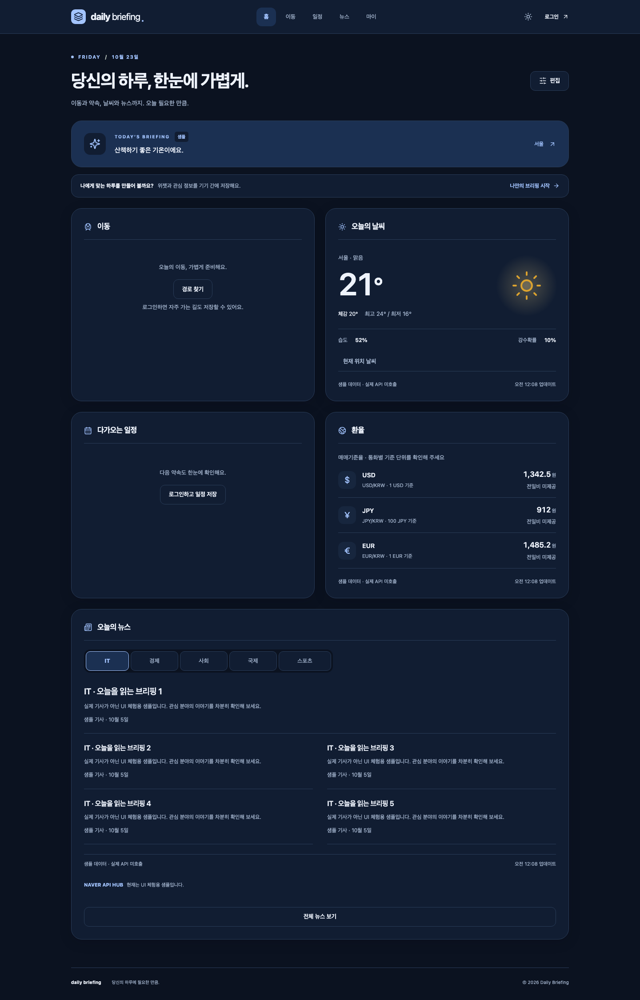

카카오맵 대중교통 전환: [설정 및 제한](docs/API_SETUP.md). 출발 시각 지정은 제거했으며, 조회된 후보 중 최단 소요시간 경로 한 개를 표시합니다.

뉴스는 NAVER API HUB의 `/search/v1/news`를 사용합니다. 네이버 클라우드 HUB 앱의 뉴스 검색 Client ID/Secret을 `.env`에 입력하세요. 이전 Developers 키와 구분해야 합니다. [설정 안내](docs/API_SETUP.md).

## AWS 인프라 코드와 실행 환경 통합

**AWS 계정 접근/리소스 생성·변경·삭제/원격 배포는 수행하지 않았습니다.** Terraform은 `infra/` 하나의 Main Root에서 `vpc`, `frontend`, `ecr`, `iam`, `alb`, `ecs`, `rds`, `nat` Child Module을 연결하고 `infra/bootstrap/`만 State 저장소용 별도 Root입니다. Main 전체를 삭제하면 S3·CloudFront DEMO도 종료됩니다. 기존 platform/live 분리 State와 인프라 자동 apply/destroy workflow는 이번 요구에 맞춰 정리했습니다.

같은 React/Spring Boot 소스를 LOCAL과 AWS에서 환경설정만 바꿔 사용합니다. 정적 DEMO는 Backend 없이 샘플을 제공하며 실제 데이터와 구분됩니다. 최초 ECR 문제는 같은 Main State의 1차 기반→수동 image push→2차 Backend 순서로 해결합니다. GitHub Actions는 인프라를 만들지 않고 앱만 배포합니다. AWS_DEPLOY_ENABLED는 미설정/false 유지가 기본입니다.

- [직접 해야 할 AWS 체크리스트](docs/MY_AWS_CHECKLIST.md)
- [AWS 최초 준비](docs/AWS_SETUP.md)
- [Terraform 구조·State·이전 주의](docs/TERRAFORM_STRUCTURE.md)
- [모든 환경변수와 발급처](docs/ENVIRONMENT_VARIABLES.md)
- [LOCAL과 AWS 비교](docs/LOCAL_VS_AWS.md)
- [수동 인프라·앱 배포·삭제·재배포](docs/DEPLOYMENT.md)
- [목표 아키텍처와 비용](docs/ARCHITECTURE.md)
- [오류 대응](docs/TROUBLESHOOTING.md)
- [실제 로컬 검증 결과](docs/INFRA_VERIFICATION.md)
- [A–L 작업 보고서](docs/AWS_CHANGELOG.md)

## 선택적 AIOps — 인프라 장애 분석과 알림

CloudWatch ERROR와 ECS 실패 이벤트를 Python Lambda에서 파싱·마스킹하고 DynamoDB로 중복/일일 한도를 관리합니다. 허용된 경우 OpenAI Responses Structured Outputs로 원인 후보를 분석하고 SNS 한국어 알림을 생성합니다. AI 실패·한도 도달은 기본 장애 알림으로 전환합니다. 계정 리소스를 자동 수정하지 않습니다.

기존 8개 모듈을 유지하며 Main에 aiops 모듈만 추가했습니다. **enable_aiops=false, ai_enabled=false가 기본**이며 실제 AWS/AI/SNS 호출·메일 수신은 미검증입니다. Python 기본 테스트는 외부 네트워크를 차단한 Mock/Fake 검증입니다.

- [설계와 한계](docs/AIOPS_ARCHITECTURE.md)
- [로컬 테스트와 Lambda ZIP](docs/AIOPS_LOCAL_TEST.md)
- [향후 사용자 배포·검증·삭제](docs/AIOPS_AWS_DEPLOYMENT.md)
- [비용·개인정보·권한·중복 정책](docs/AIOPS_COST_SECURITY.md)
- [사용자 작업 체크리스트](docs/AIOPS_CHECKLIST.md)
- [A–I 변경/검증 보고서](docs/AIOPS_REPORT.md)
- [실제 측정 기록 양식](docs/AIOPS_MEASUREMENTS.md)
