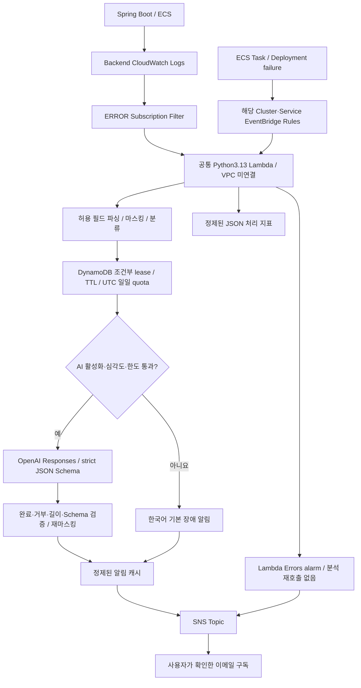

# Daily Briefing AIOps 아키텍처

코드 구현과 로컬 Mock 검증만 수행했습니다. AWS 계정 조회/리소스 생성·변경·삭제, Terraform plan/apply/destroy, 실제 OpenAI/SNS 호출 및 이메일 발송은 하지 않았습니다.

기존 8개 모듈을 유지하고 `infra/modules/aiops`를 Main의 9번째 선택 모듈로 추가했습니다. 별도 State나 Lambda 전용 NAT가 없습니다. ECS 모듈이 log group name/ARN, cluster ARN, service ARN/name을 출력하여 연결합니다. 기본 `enable_aiops=false`, `aiops_settings.ai_enabled=false`입니다. AIOps를 켜더라도 AI는 별도 허용해야 합니다.

## Python 파일

| 파일 | 역할 |
|---|---|
| handler.py | 파싱→마스킹→분류→중복/한도→AI/기본 알림→SNS, 원문 없는 지표 |
| event_parser.py | base64/gzip/JSON, 여러 logEvents/CONTROL/잘못된 입력과 두 ECS 이벤트 |
| log_sanitizer.py | 허용 필드 외 수집 배제, credential/PII 마스킹, 본문+주요 stack 제한 |
| error_classifier.py | 고정 errorCode/Exception/httpStatus/stopCode 기반 우선 유형 |
| deduplicator.py | 정규화 SHA256, 조건부 claim/owner lease, TTL, 원자적 일일 quota |
| gpt_analyzer.py | 키 ARN lazy 읽기, 공식 SDK Responses, strict schema + 독립 jsonschema 검증 |
| sns_notifier.py | 한국어 상태별 알림 생성/재마스킹/Publish |
| config.py | 환경변수와 보수적 한도, AI OFF 기본 |

Spring은 기존 plain text 형식/MDC Request ID를 유지합니다. `Errors.java`의 5xx ApiException에 errorCode/httpStatus/Exception명만 ERROR로 기록하도록 보완했습니다. 상세 provider 응답/비밀번호/요청 본문/전체 예외 객체를 출력하지 않습니다. 기존 INFO/WARN 성공·실패 로그도 유지합니다. JSON 로그는 level/message/timestamp/exception/requestId/logger/errorCode/httpStatus/stack_trace의 scalar만 허용합니다.

## 감지 범위와 정상 종료

Task 이벤트는 실제 clusterArn+group=service:backend+STOPPED이고 TaskFailedToStart 또는 EssentialContainerExited인 경우만 받습니다. 필수 backend 컨테이너의 종료코드0은 제외하며 UserInitiated/ServiceSchedulerInitiated/정상 rolling/scaling 종료는 무시합니다. Deployment 이벤트는 실제 service ARN과 SERVICE_DEPLOYMENT_FAILED만 받습니다. 이 이벤트에는 clusterArn 필드가 없으므로 서비스 ARN으로 제한합니다. circuit breaker 실패 이벤트는 기존 ECS 설정을 재사용합니다.

계획된 종료라도 앱이 ERROR를 출력할 수 있어 종료 전 `processing_enabled=false`를 일반 사용자 인프라 변경 절차로 선반영하는 운영 방법을 제공합니다. 이때 Subscription은 제거되고 Rule은 비활성화되며 이미 대기 중인 호출도 SNS/GPT를 생략합니다.

INFO/DEBUG와 분류 불가능한 단순 ERROR는 분석/알림에서 제외합니다. 원시 stack 여러 줄이 AWS에서 개별 logEvent로 분리되면 모든 프레임을 재조립하지 않습니다. DB 연결/설정/외부 API/timeout/HTTP500/ECS 실패의 고정 정보가 우선입니다. CPU·메모리 같은 기존 인프라 alarm은 여전히 각 서비스 모듈이 담당하며 AIOps 입력으로 추가하지 않았습니다.

## 실패·중복의 의미

중복 기간 기본30분. DynamoDB TTL 삭제는 지연되므로 `expires_at`을 조건식에서 직접 검사합니다. owner/75초 lease는 동시 분석을 막고 중단된 호출을 회수합니다. 한도와 중복은 메모리 캐시가 아닌 공유 테이블을 사용합니다. AI 실패도 일일 예약 횟수를 소비하고 SDK 내부 재시도는0회입니다. SNS 실패는 정제한 메시지를 캐시하여 Lambda 비동기 재시도에서 AI 재호출을 줄입니다. Lambda 재시도2회/최대 이벤트 수명1시간이며 EventBridge 대상 전달 실패도2회로 제한합니다.

SNS는 정확히 한 번 전달을 보장하지 않습니다. 게시 성공 직후 State 기록 전에 중단되거나 응답이 유실되면 중복 이메일이 생길 수 있습니다. AWS 재시도 종료 후에도 실패한 알림은 손실될 수 있습니다. 원본 이벤트를 별도 DLQ에 복제하지 않는 단순 초기 구조이며 Lambda Errors 알람/로그 지표로 수동 조사합니다. DynamoDB 장애 때는 GPT를 fail-closed하고 재시도합니다. 모든 장애 상황에서 이메일 수신을 보장한다고 주장하지 않습니다.

## 보안·AI 근거

로그는 분석 데이터이며 지시문이 아닙니다. AI에 계정 조회/수정 도구를 주지 않고 결과는 Schema에 맞는 원인 **후보**로만 렌더링합니다. `store=false`는 사용하지만 모든 공급자 보관 정책을 완전히 제거한다는 의미는 아닙니다. 외부 전송 여부는 사용자가 데이터 정책과 함께 판단해야 합니다. 정규식은 완전한 DLP가 아니므로 AI 기본 OFF/필드 배제/길이 제한/출력 재마스킹을 함께 적용합니다.

공식 구현 근거: [OpenAI Structured Outputs](https://developers.openai.com/api/docs/guides/structured-outputs), [GPT-4.1 mini 지원 기능](https://developers.openai.com/api/docs/models/gpt-4.1-mini), [CloudWatch 구독 압축 형식](https://docs.aws.amazon.com/AmazonCloudWatch/latest/logs/SubscriptionFilters.html), [ECS 배포 이벤트](https://docs.aws.amazon.com/AmazonECS/latest/developerguide/ecs_service_deployment_events.html). 모델은 환경변수로 지정하며 최신/최저가 모델이라고 단정하지 않습니다.

설치 전 과거 로그를 자동 수집하지 않습니다. 최초 ECS와 AIOps를 동시에 만들면 구독/Rule 준비 전 오류가 누락될 수 있으므로 기존 Backend 뒤에 설치한 후 이후 배포 실패를 검증하세요. 배치의 고유 장애/메일 한도를 넘는 생략도 [비용 정책](AIOPS_COST_SECURITY.md)의 의도된 보호 정책입니다.
