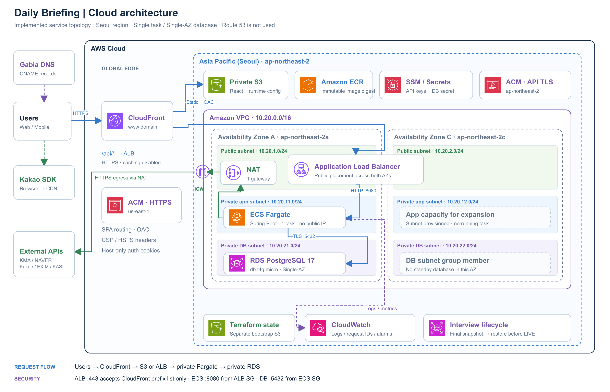
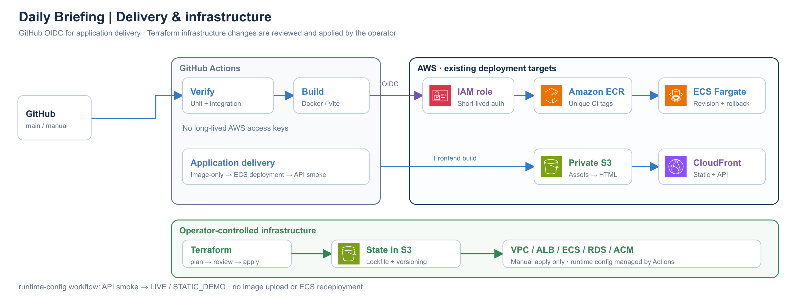
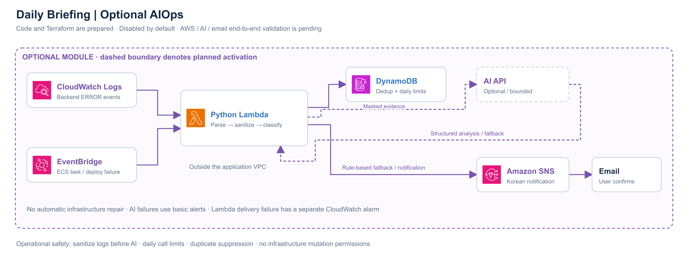

# Daily Briefing 클라우드 아키텍처

이 문서는 현재 Terraform과 애플리케이션의 요청 경로·보안 경계·운영 책임을 설명합니다. AWS 리소스 목록을 실시간 조회한 보고서가 아닙니다. 서비스는 사용자 적용으로 배포했으며, AIOps 활성화와 면접용 중단·복원 왕복 검증은 별도로 남아 있습니다.

## 1. 서비스 네트워크

[SVG 원본](assets/architecture/cloud-architecture.svg)

가비아는 도메인 등록과 DNS를 담당합니다. www CNAME은 CloudFront, api CNAME은 ALB에 연결합니다. DNS는 HTTP 요청의 중계 서버가 아닙니다. Route 53 Hosted Zone·Resolver Endpoint는 Terraform에서 생성하지 않습니다.

### 인터넷 → 화면 / API

- 브라우저의 HTTPS 종료 지점은 CloudFront입니다. 화면용 ACM 인증서는 us-east-1, API 원본용 ACM 인증서는 ap-northeast-2에서 관리합니다.
- 정적 파일은 private S3에 보관하고 OAC로 CloudFront만 읽도록 허용합니다. S3는 versioning/AES256/Public Access Block/TLS 정책을 사용합니다.
- 실제 SPA 경로만 CloudFront Function에서 index.html로 rewrite합니다. /api, assets, 알 수 없는 파일 오류를 HTML 200으로 덮지 않습니다.
- /assets/*는 hash 기반 캐시, HTML과 runtime-config는 cache disabled/no-store 전략입니다. API behavior도 CachingDisabled를 사용합니다.
- /api/*는 `api.dailybriefing-son.site` 원본으로 HTTPS 전달합니다. AllViewerExceptHostHeader 정책으로 Authorization/Cookie/CSRF 등을 전달하며 브라우저 API 주소는 같은 출처 /api/v1입니다.

### VPC / AZ / 서브넷

VPC: `10.20.0.0/16`, 기본 리전: 서울.

| Tier | ap-northeast-2a | ap-northeast-2c | 현재 배치 |
| --- | --- | --- | --- |
| Public | 10.20.1.0/24 | 10.20.2.0/24 | ALB 양쪽 AZ, NAT는 2a에 1개 |
| Private App | 10.20.11.0/24 | 10.20.12.0/24 | Fargate 1 Task는 2a, public IP 없음 |
| Private DB | 10.20.21.0/24 | 10.20.22.0/24 | DB subnet group은 두 AZ, 실제 RDS는 Single-AZ 2a |

두 번째 AZ의 서브넷은 존재하지만 실행 Task/Standby DB는 없습니다. ALB의 두 AZ 배치만으로 애플리케이션과 DB가 HA가 되는 것은 아닙니다.

### 보안 그룹 / 아웃바운드

| 통신 | 제한 |
| --- | --- |
| CloudFront → ALB 443 | CloudFront origin-facing managed prefix list |
| ALB → ECS 8080 | ECS SG가 ALB SG만 허용 |
| ECS → RDS 5432 | DB SG가 ECS SG만 허용 |
| ECS → 외부 HTTPS | App route → NAT Gateway → Internet Gateway |
| DB → 인터넷 | 기본 인터넷 경로 없음 |

CloudFront prefix list는 CloudFront 네트워크의 접근을 제한하는 것이며 특정 distribution의 소유권을 증명하지는 않습니다. 필요하면 origin secret header/WAF 등 추가 원본 인증을 별도로 설계해야 합니다. 구현하지 않은 보호 기능을 현재 구성에 포함시키지 않습니다.

ECS는 외부 공급자뿐 아니라 ECR 인증/레이어, SSM, Secrets Manager 등 AWS 공개 endpoint 접근에도 NAT를 사용합니다. VPC endpoint는 추가하지 않았습니다. 지도 SDK·타일은 브라우저에서 직접 로드합니다. CSP에는 dapi.kakao.com과 실제 지도 엔진 CDN t1.kakaocdn.net을 허용합니다.

## 2. 인증과 데이터

- JWT Access Token은 메모리에 보관합니다. 15분 만료와 session family DB 검증을 적용합니다.
- Refresh Token은 host-only / HttpOnly / Secure / SameSite=Lax Cookie에 보관합니다. DB에는 hash만 저장하고 rotation·재사용 감지를 처리합니다.
- CSRF를 비활성화하지 않습니다. 변경 요청 직전에 token을 확인하고 동시에 시작한 조회만 공유합니다. CORS는 허용 frontend origin 목록을 사용합니다.
- 로그아웃 성공 후 메모리 인증·개인 Query 캐시를 비웁니다. 서버가 거절한 로그아웃을 성공으로 숨기지 않습니다.
- 사용자 식별은 JWT principal에서 결정합니다. 일정/즐겨찾기/설정은 사용자 소유권 조건으로 조회·수정합니다.
- PostgreSQL 17의 schema 변경은 Flyway V1–V8로 관리합니다. RDS는 private endpoint와 TLS verify-full을 사용합니다.
- API/JWT Secret 원문은 Terraform이나 Git에 넣지 않습니다. Execution Role이 지정 ARN을 읽어 컨테이너에 주입합니다. RDS master password는 RDS 관리 Secret을 사용합니다.

## 3. CI/CD와 설정 소유권

GitHub OIDC는 frontend/backend Environment 이름에 맞는 IAM Role을 사용합니다. Actions는 앱 artifact·ECS revision·공개 runtime 설정을 배포하며 Terraform State/VPC/RDS/IAM을 변경하는 역할을 맡지 않습니다.

Frontend는 assets를 먼저, HTML을 나중에 올리고 runtime-config를 제외합니다. Backend는 최초 이미지부터 ECR로 올릴 수 있으며, ECS 배포 스위치가 켜진 경우에만 기존 서비스를 갱신합니다. readiness뿐 아니라 신규 revision 반영과 API 계약을 확인한 후 LIVE로 전환합니다.

| 대상 | 소유권 |
| --- | --- |
| VPC / Subnet / SG / NAT / ALB / ECS 설정 / RDS / ACM | 운영자가 수동 검토·적용하는 Terraform |
| ECS service의 실제 task revision | 앱 배포 Actions. Terraform은 task_definition을 ignore |
| runtime-config.json 초기 객체 | Terraform이 최초 샘플 설정으로 생성 |
| runtime-config 내용과 메타데이터 | runtime-config / backend-deploy Actions. Terraform은 ignore_changes=all |
| 가비아 CNAME | 운영자 수동 등록·변경 |
| State 버킷 | 별도 bootstrap Root, S3 versioning + native lockfile |

Terraform과 CI가 같은 runtime 파일을 서로 다른 내용으로 재업로드하지 않도록 소유권을 명확히 합니다. CI에는 인프라 자동 apply/destroy workflow가 없습니다.

## 4. 관측과 선택적 AIOps

애플리케이션 로그는 requestId, HTTP method/path/status/latency, 외부 API 결과를 포함합니다. 토큰·비밀번호·API 키·개인 일정 메모는 출력하지 않습니다. ECS awslogs와 CloudWatch 지표·알람을 사용합니다. ALB readiness는 DB를 포함하고, liveness는 외부 API 장애로 컨테이너를 무조건 재시작하지 않도록 분리합니다. 운영 Swagger/metrics 공개는 기본 비활성화합니다.

AIOps는 현재 미활성입니다. Backend ERROR 구독과 ECS 실패 EventBridge → Python Lambda → 분류/마스킹 → DynamoDB 중복·사용량 관리 → 선택적 AI → SNS 이메일 구조입니다. Lambda는 앱 VPC에 연결하지 않습니다. 실제 AI 호출/메일 발송/운영 부하는 아직 검증되지 않았습니다. [AIOps 설계](AIOPS_ARCHITECTURE.md)

## 5. 비용과 면접용 생명주기

항상 실행하는 HA보다 개인 프로젝트의 이해 가능성·비용 통제·복구 절차를 우선했습니다. 운영 tfvars의 Fargate는 0.25 vCPU / 1GiB, RDS db.t4g.micro / gp3 20GiB이며 이 값이 모든 계정에서 무료라는 뜻은 아닙니다. NAT·ALB·공인 IPv4·Secret·로그·스냅샷 등 부가 비용도 발생합니다.

면접 중단은 running → prepare-suspend → suspended, 재개는 스냅샷을 지정한 running입니다. CloudFront/S3/ECR/ACM/VPC/State를 보존하고 실행 자원을 제거합니다. DB는 최종 스냅샷 정책 적용을 별도 단계로 나누며 재개 시 원본 available 상태를 계획에서 확인합니다. www/인증서 DNS는 유지하고 api CNAME만 새 ALB로 갱신합니다.

실제 AWS 왕복 복구는 아직 미검증입니다. 면접 전날 사용자 데이터와 실제 API까지 점검해야 합니다. [전체 중단·재개 절차](INTERVIEW_OPERATIONS.md)

## 확장 시 결정할 사항

실측 부하·가용성 요구에 따라 Task 다중 AZ, NAT 장애 지점, RDS Multi-AZ, 원본 인증, 외부 API 캐시를 검토합니다. 현재 Redis·EKS·멀티리전 DR·뉴스 ML 파이프라인은 구현하지 않았습니다. AIOps 활성화도 별도 사용자 검토·적용 단계입니다.

그림은 [AWS 공식 아이콘](https://aws.amazon.com/architecture/icons/)으로 작성했습니다. [편집 원본/재생성](assets/architecture/README.md)
