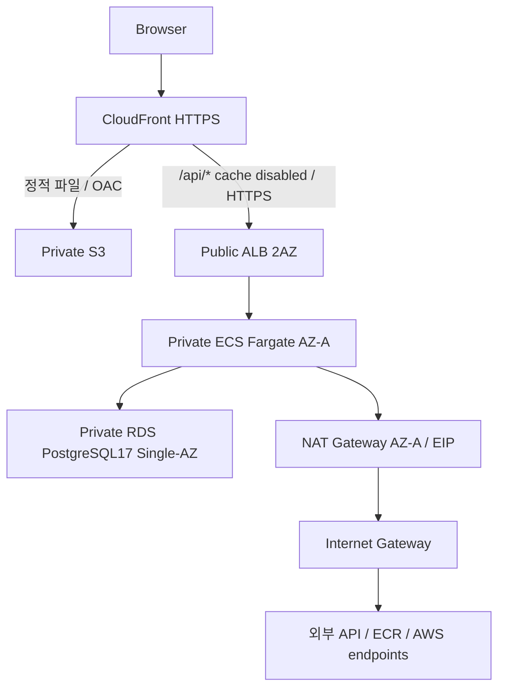

# AWS 목표 구조

코드 정의만 완료했습니다. AWS 계정/리소스 접근이나 배포는 실행하지 않았습니다.

서울 VPC 10.20.0.0/16. Public .1/.2, App .11/.12, DB .21/.22 /24. DB에 인터넷 기본 라우트가 없습니다. ECS는 Public IP 없이 NAT HTTPS로 ECR 인증/레이어(S3 포함), Secrets Manager/SSM 및 외부 API에 접근합니다. VPC endpoint를 추가하지 않았습니다.

ALB443은 CloudFront origin-facing managed prefix list만 허용합니다. 일반 브라우저의 ALB 직접 접속은 차단됩니다. ECS8080은 ALB SG만, RDS5432는 ECS SG만 허용합니다. ECS outbound는 HTTPS443 및 DB5432입니다. Route53 API alias/서울 ACM을 통해 CF→ALB도 HTTPS로 연결합니다.

Frontend 기본 CloudFront 도메인의 HTTPS DEMO는 자체 도메인 없이 가능합니다. LIVE는 **실제 API 도메인/Public Hosted Zone/서울 ACM 인증서가 필요**합니다. ALB 기본 DNS 이름에는 사용자 인증서를 발급할 수 없어 HTTP 우회를 제공하지 않습니다. frontend 사용자 도메인은 선택이며 us-east-1 ACM 및 DNS 연결이 별도로 필요합니다.

모든 브라우저 API는 `/api/v1` same-origin입니다. CloudFront API behavior는 CachingDisabled/AllViewerExceptHostHeader로 Authorization/Cookie/CSRF를 전달합니다. Access token은 메모리, refresh는 host-only HttpOnly/Secure/SameSite=Lax, rotation과 CSRF 유지입니다. 기존 CORS는 실제 frontend origin 목록만 허용합니다.

S3는 private/versioned/AES256/TLS-only이고 OAC distribution만 읽습니다. SPA function은 실제 UI 경로만 index로 변환하며 `/api/*`, assets, 알 수 없는 파일 오류는 보존합니다. runtime-config는 no-store, asset은 hash 기반 캐시입니다.

Backend는 같은 nonroot image, prod profile/RDS verify-full 공개 CA를 사용합니다. RDS가 master secret을 관리하고 Terraform에는 ARN만 남습니다. ECS Execution Role만 DB/JWT/API Secret을 읽으며 Task Role은 앱 AWS API 권한이 없습니다. Secret rotation이 환경변수를 자동 갱신하지 않으므로 회전 후 ECS 재배포가 필요합니다.

Actuator liveness는 DB/외부 API 장애로 컨테이너를 재시작하지 않으며, readiness는 DB를 포함합니다. ALB는 readiness, ECS는 liveness를 검사합니다. 로그는 requestId/latency/외부 API 결과이며 토큰/키/비밀번호를 남기지 않습니다. 7개 CloudWatch alarm은 계정에서 측정 후 임계값을 조정해야 합니다.

초기 1 task/1 NAT/Single-AZ RDS는 완전한 HA가 아닙니다. ECS를2개 AZ로 확장해도 NAT/RDS 장애 지점은 남습니다. 확장 시 calendar cleanup은 기본 비활성화되며 단일 실행 주체를 별도 결정하세요.

## 비용과 종료

Fargate/NAT/EIP/ALB/RDS/Secrets Manager/CloudWatch Alarm/로그/S3/CloudFront/ECR 비용이 발생할 수 있습니다. 고정 금액이나 무료 보장을 하지 않습니다. 실제 가격은 사용자 계정/서울 리전에서 확인하세요. Budgets/Cost Allocation Tag는 사용자가 설정합니다. Project/Environment/ManagedBy 태그는 Root provider가 부여합니다.

Main 전체 삭제는 프런트엔드도 종료합니다. State bucket, 사전에 사용자가 준비한 Secret/ACM/Hosted Zone, 공유 OIDC, 선택적 snapshot/백업/잔존 이미지·로그/서비스 연결 Role은 별도 확인 대상입니다. DB protect와 storage cleanup=false는 기본 안전장치입니다. [삭제 절차](DEPLOYMENT.md)를 확인하세요.
