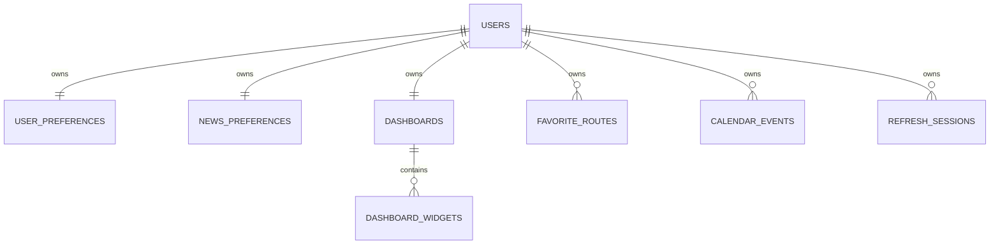

# Daily Briefing Product & Architecture

이 문서는 현재 제품 기준 설계이며 이동·일정 변경 전용 설계와 테스트 계획은 [V2_MOBILITY_UPGRADE](V2_MOBILITY_UPGRADE.md)에 있습니다.

## 1. Product Requirements

개인화 daily dashboard. 서비스 정보는 이동·날씨·환율·뉴스, 개인 영역은 일정·즐겨찾기·dashboard·preferences. Guest는 먼저 체험하고 가입 시 개인 공간을 저장합니다. 모바일/desktop 동일 기능, 다른 interaction. 과도한 enterprise 구조를 사용하지 않습니다.

## 2. 주요 User Scenario

처음 방문→기본 정보/교통 조회→위젯 선택→가입→지역/위젯/뉴스 취향→즐겨찾기/일정→다음 접속에도 유지. 데이터 장애 시 해당 widget만 retry. 탈퇴 후 데이터와 session 완전 삭제, 재가입은 새 user.

## 3. Page Map

| Path           | 역할               | 접근                       |
| -------------- | ------------------ | -------------------------- |
| /              | Dashboard/편집     | Guest/로그인               |
| /transit       | 장소/경로/즐겨찾기 | 조회 공개, 저장 인증       |
| /calendar      | 공휴일/개인 일정   | 공휴일 공개, 일정 인증     |
| /news          | 뉴스 필터/원문     | 공개                       |
| /my            | Profile/계정/설정  | Guest 안내, 개인 기능 인증 |
| /settings      | Appearance         | 공개                       |
| /login /signup | 인증               | 공개                       |
| /onboarding    | 지역/위젯/뉴스     | 인증                       |

## 4. Desktop User Flow

Header→홈 grid→편집 Dialog→drag/keyboard→저장. 이동→검색 form+즐겨찾기 panel→추천1개→단계→저장. 일정→month grid→selected agenda→edit Dialog. My→profile/theme/password/account.

## 5. Mobile User Flow

Bottom 홈/이동/일정/뉴스/마이의5개 직접 메뉴. dashboard 위젯 CTA에서도 해당 기능으로 이동. 경로는 저장 경로 우선, 일정은 agenda 중심. 편집/일정 등록은 bottom sheet. 위젯 위/아래 버튼으로 touch drag 없이 편집 가능.

## 6–7. Wireframes & Responsive 변화

| Screen          | 목적/주요 정보            | Action/components                  | Mobile                 | Desktop                |
| --------------- | ------------------------- | ---------------------------------- | ---------------------- | ---------------------- |
| Guest Dashboard | 제품 가치, 정보 샘플/출처 | 위젯편집/가입, Card/Badge          | 세로 cards             | 2열 + 뉴스 full width  |
| User Dashboard  | 나의 이동/다음3일정/정보  | 경로/일정 바로가기                 | 한손 CTA               | 비교 grid              |
| Login           | 인증/오류                 | email/password/submit              | 짧은 form              | story + form           |
| Signup          | 새 개인공간               | nickname/email/password            | form                   | story + form           |
| Onboarding      | 결정 한개씩               | step/skip                          | 한 화면 한 결정        | 좁은 centered form     |
| Dashboard Edit  | 선택/순서                 | catalog/drag/move/delete           | sheet, 이동버튼        | Dialog, keyboard DnD   |
| My              | 개인 선호/보안            | profile/news/theme/password/delete | stacked sections       | 2열 sections           |
| Transit         | 이동과 소요시간           | autocomplete/swap/routes/favorite  | saved first, 세로 결과 | 검색+saved, 결과 cards |
| Calendar        | 공휴일/약속               | 날짜 선택/CRUD                     | 작은 날짜grid+agenda   | 큰 month+side agenda   |
| News            | 제목/출처/요약            | category/keyword/original          | 가독성 list            | 넓은 list              |
| Settings        | appearance                | Light/Dark/System                  | touch controls         | 동일 선택              |

정적인 상세 wireframe은 변경 설계 참조. 중요한 숫자/제목을 먼저 보여주고 부가정보는 단계적으로 공개. Tooltip/hover만으로 제공하는 필수 action 없음. text와 color를 함께 사용, focus-visible/return, reduced motion.

## 8. Component Architecture

Feature 중심, UI reuse(Button/Input/Card/Sheet/Notice/Skeleton/Badge/Empty/QueryContent). TanStack Query는 서버 상태/독립 widget loading/error/cache/refetch. Zustand는 memory session/theme, Guest widget preference는 별도 localStorage. Registry는 component와 catalog를 함께 구성.

## 9. Backend Domain Architecture

Modular monolith: auth/user/security/dashboard/transit/calendar/weather/exchange/news/briefing. Controller=contract, Service=business/transaction, Repository=persistence, Client/Provider=external mapping. Entity를 response로 반환하지 않음. 서버 외부 응답 cache는 사용하지 않음. timeout 필수, 일괄 retry 없음.

## 10. Database ERD

FK/index/delete 정책은 변경 설계7–9, 실제DDL은 V1–V8. 기존 migration 변경 금지. PostgreSQL source of truth, H2/Redis 없음.

## 11. Authentication Flow

Signup→BCrypt→user/preferences/dashboard→refresh random256bit→SHA256DB→HttpOnlycookie→JWT15분(memory). Refresh→rowlock→old revoke→rotation→동일family access. Replay→family revoke. Access→issuer/expiration/sessionfamily DB확인. Logout/password/delete→session무효. CSRF cookie/header, Secure prod, SameSiteLax, CORSorigin한정.

## 12. Widget Architecture

공통 id/type/enabled/order/size/settings. 독립 query key. registry 신규component+type 등록, Backend TYPES 추가. settings JSONB는 feature별 옵션만. resizing은 확장 예정. Today's Briefing rule module은 providerfailure별 partial response, AI는 후속 client.

## 13. API Specification

실행 중 Swagger와 변경 설계10의 표를 계약으로 사용합니다. Error: timestamp/status/code/message/path/requestId 및 validation details. 사용자용 친근한 문구, 민감한 예외 원문은 출력하지 않음. 일정 range최대366일/500개, favorite최대20, Upcoming SQL LIMIT3. 개인 API는 JWT user조건으로 조회하며 외부 userId 입력 없음.

## 14. Docker Architecture

Browser→Frontend nginx sameorigin/api proxy→Backend→postgres service DNS. Nonroot/multistage, healthchecks, persistentvolume, env injection. Dev에서는 Vite/IDE+DockerDB. Integration은 Compose3containers.

## 15. AWS Target

Route53→CloudFront→S3 React static + /api/*→ALB→PrivateECS→RDS. PrivateECS→NAT→외부API. 환경값/secret 교체, healthreadiness. AWS/Terraform 리소스를 현재 만들지 않음. [AWS_READINESS](AWS_READINESS.md).

## 16. 단계별 계획

설계→Foundation→Auth→Dashboard→정보clients→이동/일정/개인화→cleanup/삭제/권한→실제PG통합test→Docker/browserQA→문서. 각 단계의 실패를 수정 후 진행. 이후 실제외부키계약/지도운영QA/음력·절기/실기기/운영정책/AWS실배포/AI 순으로 확장합니다.

현재 UI 토큰·카드 배치와 미사용 코드 정리: [UI_REFRESH](UI_REFRESH.md).
