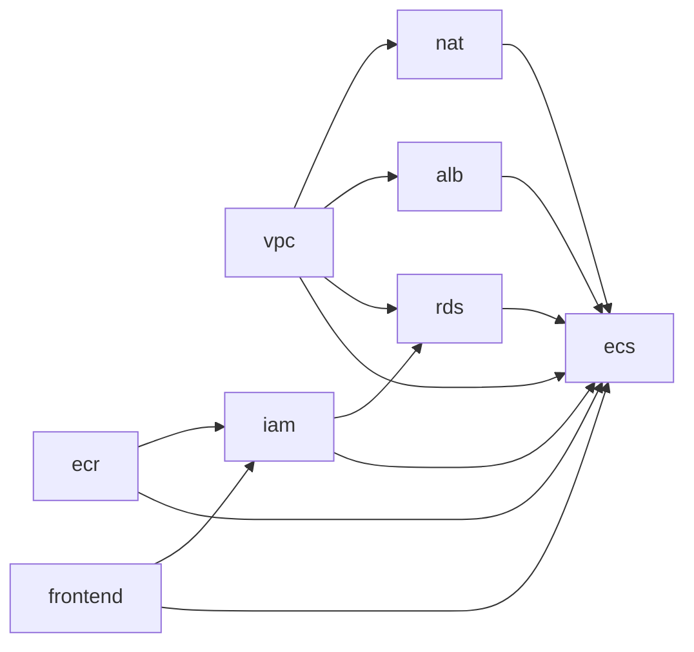

# Terraform 디렉터리와 역할

기존 서비스별 **8개 Child Module + 선택적 AIOps**를 `infra/main.tf`에서 직접 호출합니다. Main State는 하나이며 Bootstrap만 별도 Root/State입니다. AWS 계정 접근이나 plan/apply/destroy는 실행하지 않았습니다.

```text
infra/
├── main.tf                  # 아래 8개 모듈 호출 + 입력/출력 연결
├── variables.tf             # 사용자 설정/기본값/검증
├── outputs.tf               # 배포에 필요한 URL/자원 식별자
├── providers.tf             # AWS 리전/허용 계정/공통 태그
├── versions.tf              # Terraform/provider 버전
├── backend.tf               # Main S3 State + use_lockfile=true
├── moved.tf                 # 이전 단일 Main 주소 호환 선언, 실행 명령 아님
├── backend.hcl.example
├── terraform.tfvars.example
├── .terraform.lock.hcl
├── bootstrap/
│   ├── main.tf              # State 전용 S3/versioning/encryption/public block
│   ├── variables.tf
│   ├── outputs.tf
│   ├── providers.tf
│   ├── versions.tf
│   ├── backend.tf.example
│   ├── backend.hcl.example
│   ├── terraform.tfvars.example
│   └── .terraform.lock.hcl
└── modules/
    ├── vpc/
    ├── frontend/
    ├── ecr/
    ├── iam/
    ├── alb/
    ├── ecs/
    ├── rds/
    ├── nat/
    └── aiops/               # Lambda/감지/상태/알림 (기본 OFF)
```

모든 Child Module은 **main.tf / variables.tf / outputs.tf / versions.tf**를 가집니다. frontend에는 CloudFront function용 spa-router.js도 있습니다. 이전 foundation/application/network 디렉터리는 제거했습니다. 빈 폴더만 만든 것이 아니라 실제 리소스 선언을 해당 모듈로 이동했습니다.

## Root 파일 설명

| 파일 | 읽는 순서와 역할 |
|---|---|
| main.tf | 첫 진입점. module.vpc의 subnet ID를 NAT/ALB/ECS/RDS에, ECR URI를 ECS에 연결 |
| variables.tf | 사용자가 입력할 이름/계정/도메인/Secret ARN 및 기본 설정 |
| outputs.tf | 사용자가 확인하거나 GitHub Variables에 넣을 값. 비밀 원문 없음 |
| providers.tf | 어느 AWS 계정/리전에 적용할지 제한하고 Project/Environment/ManagedBy 태그 설정 |
| versions.tf | 필요한 Terraform와 AWS provider 버전 |
| backend.tf | Terraform이 관리 중인 자원을 기록하는 State 저장 위치의 형태. Backend 앱 서버 설정과 다름 |
| moved.tf | 이전 단일 Main 주소→새 모듈 주소를 Terraform이 인식하도록 선언. 실제 State 변경은 이번에 수행하지 않음 |

## 모듈 책임

| 모듈 | 관리하는 자원 | 주요 입력 → 출력 |
|---|---|---|
| vpc | VPC/6 subnet/IGW/기본 route/ALB·ECS·DB SG와 통신 규칙 | project/AZ/backend 단계 → VPC/subnet/route/SG ID |
| frontend | private S3/OAC/CloudFront/SPA function/security headers/공개 runtime | bucket/선택 domain/API origin → frontend URL/bucket/CF ID·ARN |
| ecr | immutable Backend image repository/lifecycle | project/cleanup 정책 → repository URL·ARN |
| iam | GitHub OIDC/앱 배포 역할/Task 권한 경계/선택적 service-linked roles | ECR·S3·CF ARN/저장소 subject/Secret allowlist → 역할·경계 ARN |
| alb | ALB/target group/HTTPS listener/API DNS/3개 ALB alarm | Public subnet/ALB SG/실제 API DNS·서울 ACM → target group ARN/ALB ARN |
| ecs | Fargate cluster/service/task/Task·Execution Role/backend 로그/2개 ECS alarm | App subnet/SG/image/DB·Secret ARN/ALB target/경계 → cluster/service/log group |
| rds | PostgreSQL17/DB subnet group/managed secret/RDS 로그/2개 DB alarm | DB subnet/SG/AZ/삭제 정책 → DB endpoint/Secret ARN/DB identifier |
| nat | EIP/NAT Gateway/App default route | Public subnet/App route IDs → NAT ID/EIP allocation ID |
| aiops | Lambda/로그 구독/EventBridge/SNS/DynamoDB/권한/알람 | 실제 ECS log·cluster·service ARN/ZIP/설정 → function/topic/table |

Task·Execution Role은 ECS 실행에 전용이라 ecs 안에 두며, 공통 배포 역할/권한 경계는 iam에서 관리합니다. 로그와 알람은 해당 서비스에 속합니다. SG는 vpc에서 한꺼번에 관리해 서로 다른 서비스 모듈 간 양방향 참조를 피합니다. Secret ARN은 식별자이며 비밀번호 값이 아닙니다.



리소스 참조로 생성 순서를 연결하며 명시적 depends_on은 NAT의 IGW 준비, 선택적 서비스 연결 Role, ECS가 시작되기 전 NAT/ALB listener/SG 준비를 보장하는 용도입니다. RDS 로그 그룹은 DB 생성 전에 준비합니다.

## State와 최초 배포

Bootstrap은 `bootstrap/terraform.tfstate`, Main은 `main/terraform.tfstate`입니다. Child에는 backend/provider 인증 설정이 없습니다. S3 lockfile을 사용하고 Terraform State 잠금용 DynamoDB는 추가하지 않습니다. AIOps 중복/일일 한도 테이블은 이 잠금과 별개입니다. Main 전체 삭제 시 정적 사이트도 종료되고 Bootstrap만 유지합니다.

`enable_backend=false`로 vpc/frontend/ecr/iam을 먼저 준비하고, 이미지를 ECR에 push한 뒤 true와 digest를 입력해 nat/alb/rds/ecs를 **같은 Main State**에 추가합니다. 최초 배포 순서는 [DEPLOYMENT](DEPLOYMENT.md)입니다. ECS/RDS 로그와 alarm은 각 서비스 모듈이 활성화될 때 생성합니다. true→false는 Backend 전체와 SG의 삭제 계획을 만들 수 있으므로 단순 UI 모드 전환에 사용하지 마세요. 정적 DEMO는 runtime 설정으로 선택합니다.

## 기존 State가 있는 경우

이번 작업에서 AWS State를 조회하지 않았습니다. 새로 배포하는 사용자는 그대로 새 구조를 사용하면 됩니다. 기존 자원이 있는 사용자는 State 백업과 plan 검토가 먼저입니다.

- 이전 단일 Main의 foundation/application/network 주소는 moved.tf로 새 주소에 대응시켰습니다. 파일을 작성한 것일 뿐 State 명령은 실행하지 않았습니다. 기존 backend 활성화 여부/digest/이름/설정을 그대로 유지하고, 실제 plan에 의도하지 않은 destroy/recreate가 있으면 적용하지 마세요.
- 이전 Backend 비활성화 상태에도 생성했던 공유 로그 그룹은 현재 ECS/RDS 활성화 시에 생성합니다. 이전 State에 해당 로그만 존재하는 경우 false 상태에서 삭제 계획이 생길 수 있으므로 로그 백업/활성화 설정을 확인하세요.
- 과거 **platform/live 두 State**를 갖고 있다면 moved.tf만으로 합칠 수 없습니다. 먼저 이전 설정/remote key/각 State를 안전하게 백업하고 실제 주소 목록을 검토합니다. 예: platform의 module.network.*→module.vpc.*, aws_s3_bucket.frontend→module.frontend.aws_s3_bucket.frontend, live의 aws_db_instance.main→module.rds[0].aws_db_instance.main.
- 두 State 합치기는 작업 중단/잠금/주소별 소유권 매핑 후 검토된 local State mv 또는 import 절차가 필요합니다. 실제 목록/lineage/중복을 확인하지 않은 state push나 자동 이동을 하지 않습니다. 이번 작업에서는 이를 실행하지 않았습니다.

Bootstrap local State는 최초 bucket 생성 후 backend 예제를 복사하고 사용자가 init -migrate-state로 이전합니다. local 백업을 안전하게 보관하고 S3 versioning으로 복구합니다. State를 잃어도 같은 버킷을 다시 생성하지 말고 이전 object version/백업을 복원하세요. active 작업 중 force-unlock을 하지 마세요. [S3 backend 공식 기준](https://developer.hashicorp.com/terraform/language/backend/s3).

AIOps는 기존 Main에서만 연결하는 9번째 선택 모듈이며 새 State가 없습니다. enable_aiops=false 및 AI OFF가 기본입니다. [AIOPS_ARCHITECTURE](AIOPS_ARCHITECTURE.md)와 [AIOPS_AWS_DEPLOYMENT](AIOPS_AWS_DEPLOYMENT.md)를 확인하세요.
