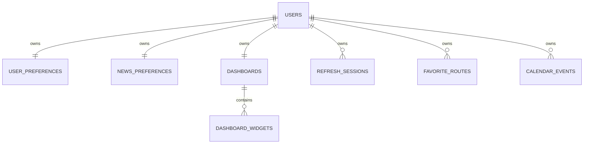

> 이전 개인 일정 확장의 설계 기록입니다. 이동/API/UI 최신 변경은 [V2_MOBILITY_UPGRADE](V2_MOBILITY_UPGRADE.md)를 기준으로 합니다.

> 과거 설계/검증 기록입니다. 2026-10-20 카카오맵 REST publictraffic으로 전환했으며 출발 시각 지정/모빌리티 제휴 플래그를 제거했습니다. 현재 설정은 [API_SETUP.md](API_SETUP.md)를 따르세요.

# Daily Briefing — 이동·일정 중심 설계

이 문서는 구현 전에 작성한 변경 설계다. 주식 기능을 종료하고 이동, 날씨, 개인 일정 중심으로 하루를 구성한다. Redis, AWS 리소스, Terraform은 추가하지 않는다.

## 1. Product Requirements

P0: 역 자동완성, 출발/도착 교환, 시간표 후보 중 대기시간을 포함해 가장 빨리 도착하는 경로 1개, 이동 단계, 즐겨찾기 생성/별명·순서 수정/삭제, 일정 CRUD, Upcoming 3, 계정 격리, 탈퇴 hard delete, 2년 이전 일정 정리. 뉴스/날씨/환율/대기질 및 대시보드 편집을 유지한다.

실제 저장은 PostgreSQL. DEMO 교통은 명시적인 샘플이며 실제 운행시간으로 안내하지 않는다. LIVE 공급자가 제공하지 않는 구간·환승 도보시간은 계산하지 않고 지원 범위를 안내한다. 초기 LIVE adapter는 서울교통공사 동일 노선의 동일 열차 번호 시간표를 연결한다. 신분당선/전국망/환승 경로는 추가 공급자 계약이 필요하다. 이 제약은 UI에도 표시한다.

## 2. Transit User Flow

이동 페이지 → 역명 입력 → 이름/노선/지역으로 선택 → 필요하면 교환 → 출발시각 선택 → 검색 → 소요시간/출발·도착/환승/단계 → 로그인 사용자는 저장 → 별명·순서 편집 → 다음 로그인에도 유지. Guest는 조회 가능, 저장 CTA로 가입 진입.

## 3. Calendar User Flow

Dashboard 가장 가까운 3개 → 전체 일정 → 월 이동/날짜 선택 → 일정 추가 → 제목/날짜(필수), 시간/장소/메모(선택) → 저장 → 수정/삭제. Mobile은 선택 날짜의 agenda, Desktop은 month grid + agenda. 공휴일과 개인 일정 query를 분리해 공공 API 장애로 개인 일정이 막히지 않는다.

## 4. Account Deletion Flow

My 계정 메뉴 → 삭제 대상 안내 → 비밀번호 확인 → DELETE users/me → DB FK cascade 한 transaction → refresh cookie 제거 → memory session/query cache 제거 → Guest Dashboard. 로그는 결과만, 비밀번호·일정 내용은 기록하지 않는다. 같은 이메일 재가입은 새 UUID로 생성.

## 5. Mobile Wireframe

```text
Home: 날짜/인사 [편집]
[오늘의 브리핑]
[이동: 즐겨찾기 2개 / 경로 보기 / 다른 경로 검색]
[날씨] [대기질]
[다가오는 일정 3개 / 전체 일정]
[환율] [뉴스]
[홈 | 둘러보기 | 마이]

Explore: [이동] [일정] [뉴스] 바로가기
Transit: [저장 경로] → [출발 autocomplete] [교환] [도착 autocomplete]
         [출발시각] [경로 찾기] → [32분 / 08:15→08:47 / 단계]
Calendar: [월 ← →] [날짜 grid: 표시점만] [선택일 agenda] [+ 일정 추가]
Event editor: Bottom Sheet + 취소/저장
My: 프로필·지역·뉴스 / 이동·일정 바로가기 / 화면 / 보안 / 계정 삭제
```

## 6. Desktop Wireframe

```text
Header 홈 둘러보기 이동 일정 마이
Dashboard: Briefing full-width
[Transit 6 cols] [Weather 6 cols]
[Upcoming 6 cols] [Weather 6 cols]
[Exchange 6 cols] [News full-width]
Transit: [검색 panel] [즐겨찾기 panel] → 추천 경로 1개 + 펼친 이동 단계
Calendar: [월간 grid 8 cols] [선택일 agenda 4 cols]
Editor: 중앙 Dialog, keyboard focus trap/return
```

## 7–9. ERD / Foreign Key / Index



FK 삭제 책임은 PostgreSQL ON DELETE CASCADE. JPA 자식 cascade를 중복 추가하지 않는다. favorite_routes는 출발/도착 id·name, nickname, display_order, created_at, updated_at 저장. 동일 계정·출발·도착 UNIQUE. calendar_events는 title, event_date DATE, event_time TIME NULL, description, location, timestamps. index: calendar(user_id,event_date,event_time), cleanup(event_date), favorites(user_id,display_order). dashboard 기존 UNIQUE(dashboard_id,position)는 조회 index로 활용.

V1–V4 적용 이력을 수정하지 않는다. V5에서 기존 종목 테이블을 제거하고 widgets의 기존 타입을 transit으로 변경한다. V6에서 일정/즐겨찾기 및 index를 생성한다. 기존 사용자의 다른 widget 선택은 유지한다.

## 10. API Specification

| Method       | /api/v1 path                                                         | Contract / access                                                 |
| ------------ | -------------------------------------------------------------------- | ----------------------------------------------------------------- |
| GET          | /transit/stations?query=성                                           | Station{id,name,line,region}[], public                            |
| GET          | /transit/routes?departureStationId=&arrivalStationId=&departureTime= | Routes{routes,meta,notice}, public; ISO local datetime Asia/Seoul |
| GET/POST     | /me/transit/favorites                                                | 현재 JWT user 기준 목록/생성                                      |
| PATCH        | /me/transit/favorites/{id}                                           | nickname, displayOrder                                            |
| DELETE       | /me/transit/favorites/{id}                                           | 소유자 조건 hard delete                                           |
| GET/POST     | /me/calendar/events                                                  | from/to 날짜 범위(최대366일)/생성                                 |
| GET          | /me/calendar/events/upcoming                                         | 오늘 기준 날짜 ASC, 시간 ASC NULLS LAST, LIMIT 3                  |
| PATCH/DELETE | /me/calendar/events/{id}                                             | 소유자 조건 수정/삭제                                             |
| GET          | /calendar/holidays?year=&month=                                      | KASI 공휴일, public                                               |
| DELETE       | /users/me                                                            | password 확인, cookie/session/cache 정리                          |

다른 사용자의 id로 수정/삭제 시 404. 인증 없는 개인 API는 401. 개인 데이터에 client userId parameter를 사용하지 않는다. 즐겨찾기 최대20, 일정 조회 최대366일·500개로 제한. DB에서 범위 조회/정렬/limit, 전체 목록 memory 정렬 금지.

## 11–12. Feature Architecture

Backend: transit{TransitController,TransitService,RouteSearchService,TransitProvider,DemoTransitProvider,SeoulTransitProvider,FavoriteRouteService,FavoriteRouteRepository}; calendar{CalendarController,CalendarService,CalendarEventRepository,HolidayService,KasiHolidayClient,CalendarCleanupService,CalendarCleanupScheduler}; 기존 auth/user/dashboard/data domains.

Frontend: features/transit{TransitPage,StationInput,TransitWidget}, calendar{CalendarPage,EventEditor,UpcomingWidget,date utilities}; 각 widget 독립 TanStack Query. Query key에 userId 포함. session 변경 시 cache clear, access token memory. 공통 Button/Sheet/Notice/QueryContent 재사용. API 설정/날짜 경계/소유자 검증에 이유를 설명하는 한국어 주석을 작성한다.

## 13. Cleanup Scheduler

Clock Bean Asia/Seoul; cutoff=LocalDate.now(clock).minusYears(2); event_date < cutoff만 삭제, 같은 날짜는 유지. 매일03:00 Asia/Seoul, bulk SQL transaction, deleted count 및 실패만 로깅. 기본 enabled, 환경변수로 schedule/enable 변경. 여러 ECS replica에서 중복 job이 실행돼도 delete idempotent; 규모 증가 시 단일 scheduler task로 분리(현재 distributed lock 도입하지 않음).

## 14. Test Plan

Unit: D-Day/date boundary, cutoff strict inequality, timetable midnight/동일 train mapping/미지원 노선/error. Testcontainers: migration, 일정 CRUD/limit/order, A/B ownership, favorite persistence/order/duplicate, cleanup boundary, account cascade 전체 table row count, old access+refresh 실패, 같은 email 재가입. Frontend: autocomplete 선택, swap, 저장 오류/empty, event editor/date utility. Playwright desktop/mobile: signup/skip → route search/favorite → calendarCRUD/upcoming → reload/logout/login persistence → deletion → Guest. Compose image build/up/health/API + 실제 PostgreSQL cascade 확인. 외부 API key 없는 live 교통/공휴일 테스트는 완료로 주장하지 않는다.
